# From Scanpy

Scanpy draws; ggann builds. A `sc.pl.*` call draws a figure at once and returns `None` or axes. A ggann helper returns a plotnine object and draws nothing. You add layers or themes to it, then save it.

```python
import scanpy as sc
import ggann as ag
from plotnine import theme_bw, labs

markers = ["CD3D", "CD8A", "NKG7", "GNLY", "MS4A1", "FCGR3A", "CST3"]
plot = ag.plot_dotplot(adata, markers, "louvain")  # nothing drawn yet
plot = plot + theme_bw() + labs(title="PBMC markers")
plot.save("dotplot.png", width=5.5, height=4, dpi=150)
```

Every helper keeps Scanpy's argument order and defaults. `groupby=` works as an alias of `group_by=`; giving both with different values raises `TypeError`. A keyword a helper does not list raises `TypeError` too. Rank-genes plots use `n_genes=10`, matrixplots show raw group means, and dotplots draw the first category at the top, as in Scanpy.

All examples use `pbmc3k_processed` and the `markers` list above. The images come from `examples/reproduce_scanpy.py`, which runs the calls shown.

## The four keywords ggann drops

`show`, `return_fig`, `save` and `ax` do not exist. Each has a replacement.

| Scanpy | ggann |
|---|---|
| `show=True` | Display the returned object, or call `plot.draw()` for a Matplotlib figure |
| `return_fig=True` | Not needed; the call already returns the plot |
| `save="x.png"` | `plot.save("x.png", width=, height=, dpi=)` |
| `ax=ax` | `ag.compose([plot_a, plot_b], ncol=2)` |

```python
fig = plot.draw()  # Matplotlib Figure
ag.save_publication(plot, "dotplot", width="single-column", height=70, formats=("svg", "png"))
figure = ag.compose([ag.plot_embedding(adata, "umap", color="louvain"), plot], ncol=2)
```

Both libraries read `.raw` when it exists and no layer is set. In ggann, `use_raw=False` forces `.X` and `layer="name"` picks a layer. Cells with a missing group value are dropped with one `UserWarning` that gives the count.

## Call by call

Each pair uses the same data. Left is Scanpy, right is ggann.

### Embedding by category: `umap`, `embedding`

::::{grid} 1 1 2 2
:gutter: 2
:::{grid-item}
**Scanpy**

```python
sc.pl.umap(adata, color="louvain")
```

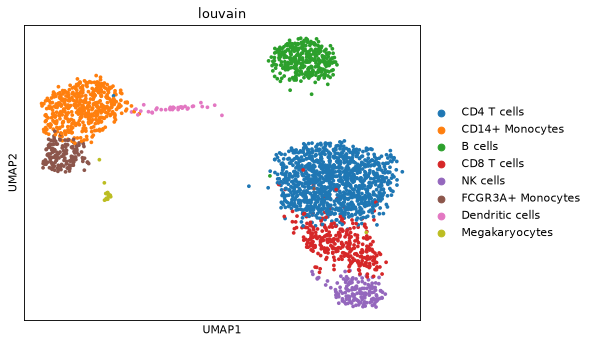
:::
:::{grid-item}
**ggann**

```python
ag.plot_embedding(adata, "umap", color="louvain", label=True)
```

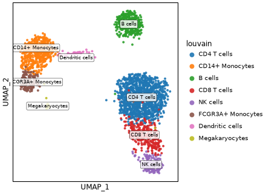
:::
::::

Use `basis=` for `sc.pl.embedding`, `tsne` or any `obsm` key. `label=True` puts group names on the data, like `legend_loc="on data"`.

| Status | Keywords |
|---|---|
| Same spelling | `basis`, `color` (name or list), `components`, `layer`, `use_raw`, `palette`, `color_map`, `vmin`, `vmax`, `vcenter` (number or `"p99"`), `groups`, `sort_order`, `na_color`, `title`, `legend_loc`, `size` (one number), `alpha`, `ncol` |
| ggann only | `split_by`, `label`, `pointdensity`, `downsample` |
| Not accepted | `projection`, `edges`, `arrows`, `add_outline`, `frameon`, `legend_fontsize`, `legend_fontweight`, `size` as an array |
| Grammar | `vmin`/`vmax` is `scale_color_gradient(limits=..., oob=squish)`; `title` is `labs(title=...)`; `legend_loc="none"` is `theme(legend_position="none")` |

### Embedding by genes: feature panels

::::{grid} 1 1 2 2
:gutter: 2
:::{grid-item}
**Scanpy**

```python
sc.pl.umap(adata, color=["CD3D", "CD8A", "NKG7", "GNLY"])
```

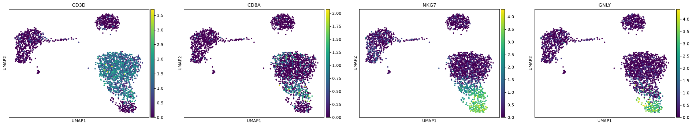
:::
:::{grid-item}
**ggann**

```python
ag.plot_features(adata, ["CD3D", "CD8A", "NKG7", "GNLY"], basis="umap")
```

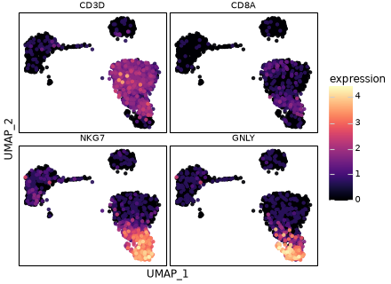
:::
::::

`plot_features` takes the gene list. Panels share one colour bar and `ncol=` sets the layout. `plot_embedding` also takes a gene list.

Accepts `basis`, `layer`, `use_raw`, `components`, `ncol`, `size`, `alpha`, `cmap` (Scanpy's `color_map`), `vmin`, `vmax`, `vcenter`, `sort_order`, `na_color`. Same limits as the categorical case.

### `sc.pl.pca`

::::{grid} 1 1 2 2
:gutter: 2
:::{grid-item}
**Scanpy**

```python
sc.pl.pca(adata, color="louvain")
```

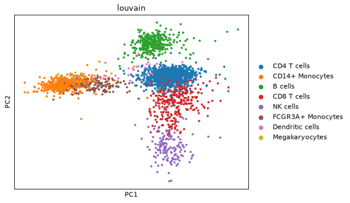
:::
:::{grid-item}
**ggann**

```python
ag.plot_embedding(adata, "pca", color="louvain")
```

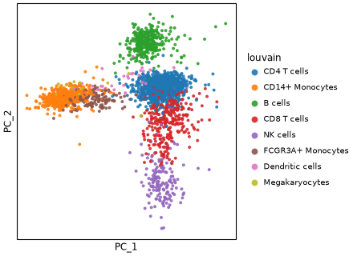
:::
::::

`basis="pca"` uses the stored `X_pca`. Pick other axes with `components=`.

Same keywords as the embedding call above.

### `sc.pl.scatter`

::::{grid} 1 1 2 2
:gutter: 2
:::{grid-item}
**Scanpy**

```python
sc.pl.scatter(adata, x="n_counts", y="n_genes", color="louvain")
```

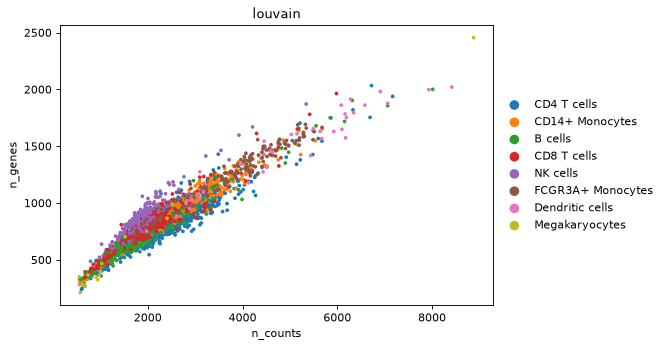
:::
:::{grid-item}
**ggann**

```python
ag.plot_qc_scatter(adata, "n_counts", "n_genes", color="louvain")
```

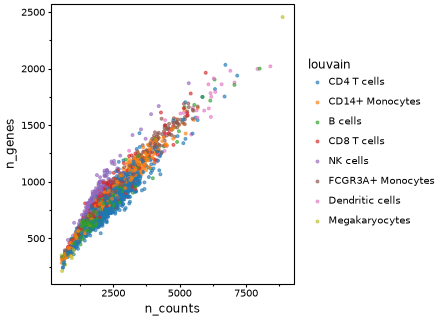
:::
::::

Use `plot_qc_scatter` for two `obs` fields or genes. For `basis=`, use `plot_embedding`.

| Status | Keywords |
|---|---|
| Same spelling | `x`, `y`, `color`, `layer`, `use_raw` |
| ggann only | `size`, `alpha`, `log` (log10 axes; non-positive values raise) |
| Not accepted | `basis`, `groups`, `components`, `palette`, `legend_loc`, `projection` |
| Grammar | `gganndata(adata, aes(x, y, color=...)) + geom_point()` |

### `sc.pl.violin`

::::{grid} 1 1 2 2
:gutter: 2
:::{grid-item}
**Scanpy**

```python
sc.pl.violin(adata, ["CD3D", "CD8A", "NKG7"], groupby="louvain")
```

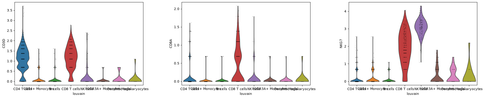
:::
:::{grid-item}
**ggann**

```python
ag.plot_violin(adata, ["CD3D", "CD8A", "NKG7"], "louvain")
```

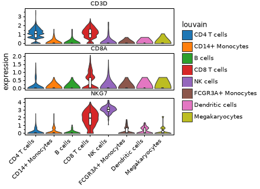
:::
::::

Genes become one facet each. `ncol=` sets the layout, so Scanpy's `multi_panel` has no switch.

| Status | Keywords |
|---|---|
| Spelling differs | `keys` is `genes`; `stripplot` is `add_points`; `jitter_size`, `jitter_alpha` for the points |
| Same spelling | `groupby`, `use_raw`, `layer`, `log` (draws `log1p`), `order`, `rotation`, `scale` |
| Not accepted | `ax`, `jitter` as a width, `size`, `xlabel`, `ylabel` (use `labs`) |

### `sc.pl.stacked_violin`

::::{grid} 1 1 2 2
:gutter: 2
:::{grid-item}
**Scanpy**

```python
sc.pl.stacked_violin(adata, markers, groupby="louvain")
```

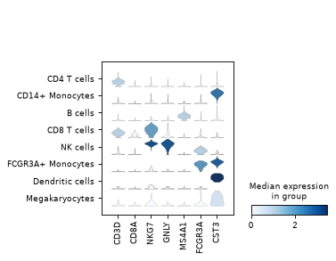
:::
:::{grid-item}
**ggann**

```python
ag.plot_stacked_violin(adata, markers, "louvain")
```

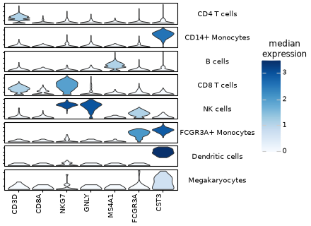
:::
::::

Groups are rows and genes run along x, as in Scanpy. Violins are filled by group median with one shared colour bar.

| Status | Keywords |
|---|---|
| Spelling differs | `var_names` is `genes` |
| Same spelling | `groupby`, `use_raw`, `layer`, `log`, `order`, `rotation`, `swap_axes`, `stripplot`, `yticklabels`, `cmap`, `scale` |
| Not accepted | `dendrogram`, `var_group_positions`, `standard_scale`, `row_palette`, `colorbar_title`, `figsize`, a dict of marker groups |
| Grammar | The violin recipe with `facet_grid("feature ~ .", scales="free_y")` and `fill` mapped to the group median |

### `sc.pl.dotplot`

::::{grid} 1 1 2 2
:gutter: 2
:::{grid-item}
**Scanpy**

```python
sc.pl.dotplot(adata, markers, groupby="louvain")
```

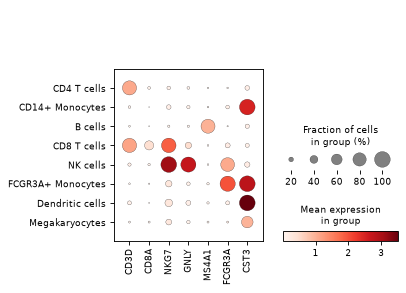
:::
:::{grid-item}
**ggann**

```python
ag.plot_dotplot(adata, markers, "louvain")
```

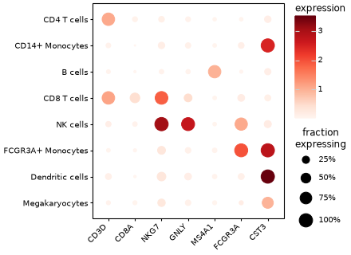
:::
::::

Colour is mean expression, size is the fraction of cells expressing. The first category sits at the top, as in Scanpy.

| Status | Keywords |
|---|---|
| Spelling differs | `var_names` is `genes` (list, or `{marker group: [genes]}` dict for one panel per group, plotnine backend); `smallest_dot`/`largest_dot` is `size_range` (plotnine size units) |
| Same spelling | `groupby`, `use_raw`, `layer`, `standard_scale` (`"var"`, `"group"`), `expression_cutoff`, `cmap`, `vmin`, `vmax`, `dot_min`, `dot_max`, `swap_axes`, `categories_order` |
| ggann only | `split_by`, `annotate`, `standard_scale="zscore"` |
| Not accepted | `dendrogram`, `var_group_rotation`, `mean_only_expressed`, `vcenter`, `gene_symbols`, `colorbar_title`, `size_title` |

Use `swap_axes=True`, not `coord_flip()`: a flip reverses the displayed order.

### `sc.pl.matrixplot`

::::{grid} 1 1 2 2
:gutter: 2
:::{grid-item}
**Scanpy**

```python
sc.pl.matrixplot(adata, markers, groupby="louvain")
```

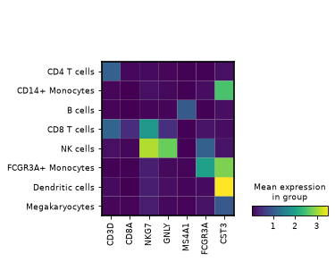
:::
:::{grid-item}
**ggann**

```python
ag.plot_matrixplot(adata, markers, "louvain")
```

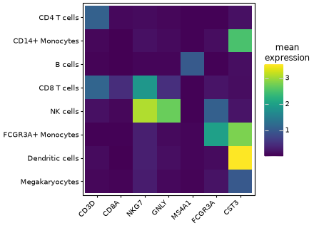
:::
::::

Both draw raw group means (`standard_scale=None`). Pass `standard_scale="var"` to rescale each gene to [0, 1] in either library.

| Status | Keywords |
|---|---|
| Spelling differs | `var_names` is `genes` (list or dict) |
| Same spelling | `groupby`, `use_raw`, `layer`, `standard_scale`, `cmap`, `vmin`, `vmax`, `swap_axes`, `categories_order` |
| ggann only | `split_by`, `annotate`, `standard_scale="zscore"` (zero-centred `RdBu_r`) |
| Not accepted | `dendrogram`, `var_group_rotation`, `vcenter`, `gene_symbols`, `colorbar_title` |

### `sc.pl.heatmap`

::::{grid} 1 1 2 2
:gutter: 2
:::{grid-item}
**Scanpy**

```python
sc.pl.heatmap(adata, markers, groupby="louvain")
```

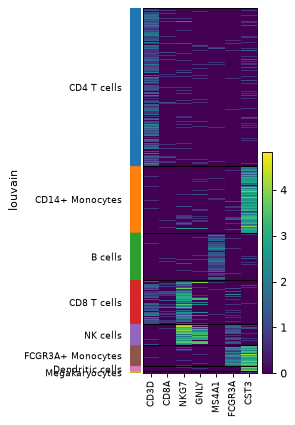
:::
:::{grid-item}
**ggann**

```python
ag.plot_heatmap(adata, markers, "louvain")
```

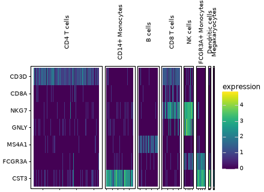
:::
::::

One tile column per cell, blocked by group. Cells keep input order within a group. For grid heatmaps with annotations see {doc}`heatmaps`.

| Status | Keywords |
|---|---|
| Spelling differs | `var_names` is `genes` (list or dict) |
| Same spelling | `groupby`, `use_raw`, `layer`, `cmap`, `vmin`, `vmax`, `swap_axes`, `standard_scale` |
| ggann only | `downsample`, `annotate` |
| Not accepted | `dendrogram`, `show_gene_labels`, `var_group_rotation`, `vcenter`, `gene_symbols` |

### `sc.pl.tracksplot`

::::{grid} 1 1 2 2
:gutter: 2
:::{grid-item}
**Scanpy**

```python
sc.pl.tracksplot(adata, markers, groupby="louvain")
```

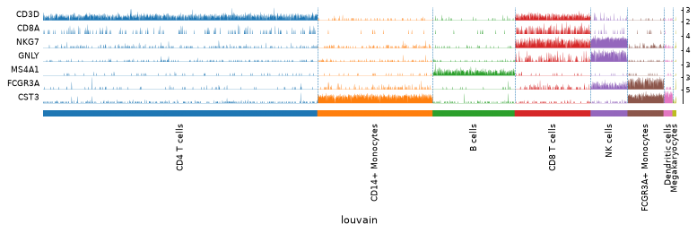
:::
:::{grid-item}
**ggann**

```python
ag.plot_tracksplot(adata, markers, "louvain")
```

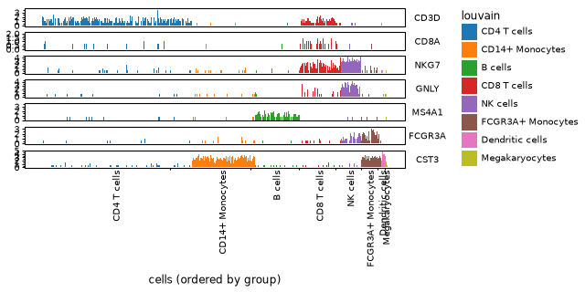
:::
::::

Drawn 8 in wide here; the labels of the two smallest groups still touch. A `{label: [genes]}` dict titles tracks `gene [label]`.

| Status | Keywords |
|---|---|
| Spelling differs | `var_names` is `genes` |
| Same spelling | `groupby`, `use_raw`, `layer` |
| ggann only | `categories_order` |
| Not accepted | `dendrogram`, `log`, `gene_symbols`, `figsize` |
| Grammar | `geom_rect + facet_grid` over the per-cell long table |

### `sc.pl.rank_genes_groups_dotplot`

::::{grid} 1 1 2 2
:gutter: 2
:::{grid-item}
**Scanpy**

```python
sc.pl.rank_genes_groups_dotplot(adata, n_genes=3, key="rank_wilcoxon")
```

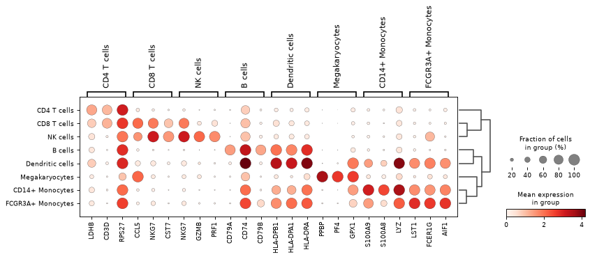
:::
:::{grid-item}
**ggann**

```python
ag.plot_rank_genes_dotplot(adata, n_genes=3, key="rank_wilcoxon")
```

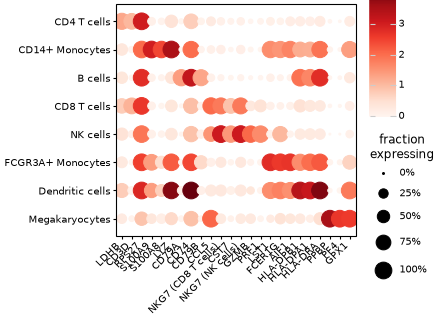
:::
::::

A gene that is a top marker of several groups gets one column per group, labelled `GENE (group)`. Scanpy draws one column inside brackets.

| Status | Keywords |
|---|---|
| Same spelling | `n_genes` (positive), `groupby`, `key`, `groups`, `min_logfoldchange`, `values_to_plot` (`scores`, `logfoldchanges`, `pvals`, `pvals_adj`, `log10_pvals`, `log10_pvals_adj`), plus the dotplot options |
| Not accepted | negative `n_genes`, marker brackets (`var_group_positions`), `dendrogram`, `gene_symbols` |
| Grammar | `rank_genes_df`, then the dotplot recipe |

`values_to_plot` draws the stored statistic, not an expression mean. It needs a result stored with `n_genes=adata.n_vars` and cannot combine with `standard_scale`.

### `sc.pl.rank_genes_groups_matrixplot`

::::{grid} 1 1 2 2
:gutter: 2
:::{grid-item}
**Scanpy**

```python
sc.pl.rank_genes_groups_matrixplot(adata, n_genes=3, key="rank_wilcoxon")
```

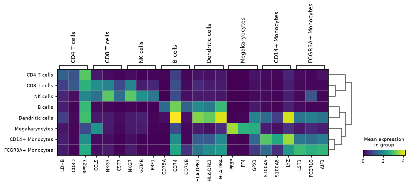
:::
:::{grid-item}
**ggann**

```python
ag.plot_rank_genes_matrixplot(adata, n_genes=3, key="rank_wilcoxon")
```

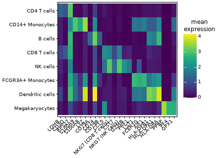
:::
::::

Same keywords as the dotplot version, plus `standard_scale`. It shows raw group means by default.

### `sc.pl.highest_expr_genes`

::::{grid} 1 1 2 2
:gutter: 2
:::{grid-item}
**Scanpy**

```python
sc.pl.highest_expr_genes(adata.raw.to_adata(), n_top=15)
```

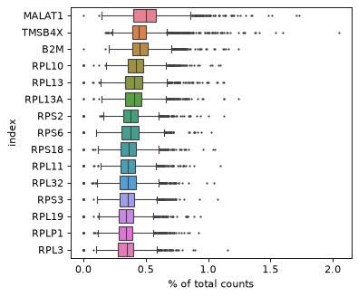
:::
:::{grid-item}
**ggann**

```python
ag.plot_highest_expr_genes(adata, n=15, use_raw=True)
```

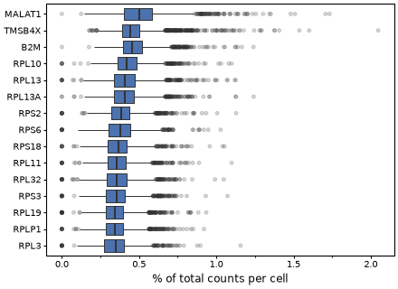
:::
::::

Scanpy reads `.X`, so the Scanpy call here passes the `.raw` copy. ggann reads `.raw` with `use_raw=True`. The default is 30 genes in both.

| Status | Keywords |
|---|---|
| Spelling differs | `n_top` or `n` (both with different values raises) |
| Same spelling | `layer`, `gene_symbols`, `log` (draws `log1p(percent)`) |
| ggann only | `use_raw` |
| Not accepted | extra Matplotlib `boxplot` keywords |

### `sc.pl.pca_variance_ratio`

::::{grid} 1 1 2 2
:gutter: 2
:::{grid-item}
**Scanpy**

```python
sc.pl.pca_variance_ratio(adata, n_pcs=30, log=True)
```

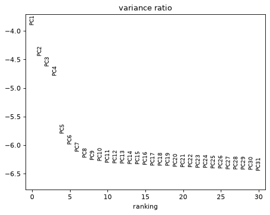
:::
:::{grid-item}
**ggann**

```python
ag.plot_variance_ratio(adata, n_pcs=30, log=True)
```

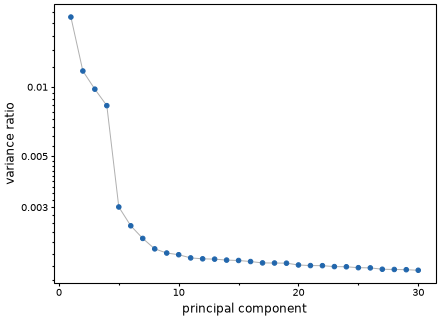
:::
::::

Defaults match Scanpy: `n_pcs=30`, `log=False`. Use `key=` for a non-default PCA slot.

### `sc.pl.dendrogram`

::::{grid} 1 1 2 2
:gutter: 2
:::{grid-item}
**Scanpy**

```python
sc.pl.dendrogram(adata, groupby="louvain")
```

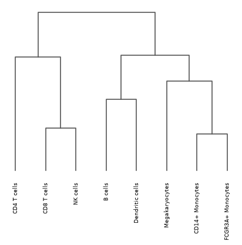
:::
:::{grid-item}
**ggann**

```python
ag.plot_dendrogram(adata, "louvain")
```

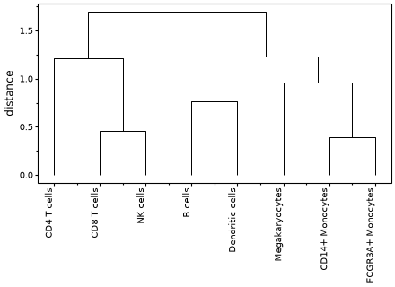
:::
::::

ggann reuses coordinates from `sc.tl.dendrogram`. If they are missing it computes them on a temporary copy and leaves `adata` unchanged.

| Status | Keywords |
|---|---|
| Spelling differs | `dendrogram_key` is `key`; `orientation` takes `"top"` or `"left"` |
| Not accepted | `"bottom"` and `"right"` orientations |
| Grammar | `geom_path` over the link coordinates |

### `sc.pl.correlation_matrix`

::::{grid} 1 1 2 2
:gutter: 2
:::{grid-item}
**Scanpy**

```python
sc.pl.correlation_matrix(adata, groupby="louvain")
```

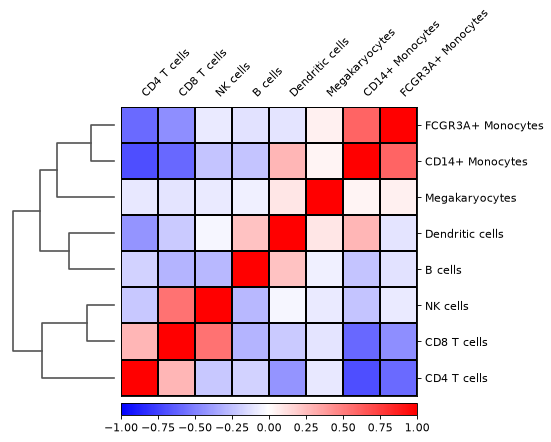
:::
:::{grid-item}
**ggann**

```python
ag.plot_correlation(adata, "louvain", use_rep="X_pca")
```

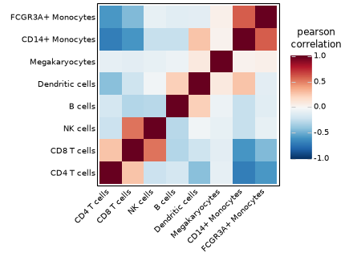
:::
::::

Scanpy correlates group means of the PCA embedding. ggann defaults to group-mean gene profiles over the highly variable genes. Pass `use_rep="X_pca"` to match Scanpy. ggann needs no `sc.tl.dendrogram` first.

| Status | Keywords |
|---|---|
| Spelling differs | `show_correlation_numbers` is `annotate` |
| Same spelling | `groupby`, `cmap` |
| ggann only | `genes`, `layer`, `use_raw`, `method`, `cluster`, `use_rep`, `n_pcs` |
| Not accepted | `figsize`, `dendrogram` (use `cluster=True`, the default) |

`use_rep` cannot combine with `genes`, `layer` or `use_raw`.

### `sc.pl.embedding_density`

::::{grid} 1 1 2 2
:gutter: 2
:::{grid-item}
**Scanpy**

```python
sc.tl.embedding_density(adata, basis="umap", groupby="louvain")
sc.pl.embedding_density(
    adata, basis="umap", key="umap_density_louvain", group="CD4 T cells"
)
```

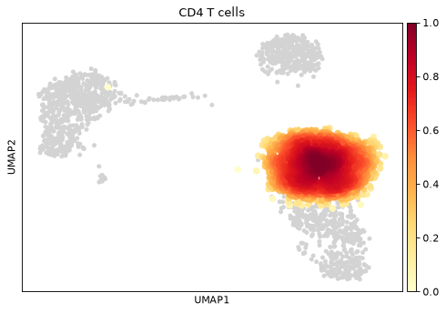
:::
:::{grid-item}
**ggann**

```python
ag.plot_embedding_density(adata, "umap", "louvain", groups="CD4 T cells")
```

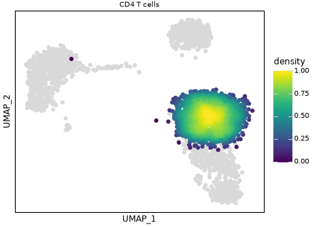
:::
::::

ggann fits the density itself, so there is no `tl` step and no `key=`. `group` is `groups=`.

## Not covered

`sc.pl.paga` and graph-layout plots are not implemented. Use Scanpy for them. Other ggann helpers have no single Scanpy counterpart: `plot_clustermap` (see {doc}`heatmaps`), `plot_density`, `plot_box`, `plot_sina`, `plot_ridge`, `plot_proportions`, `plot_volcano`, `plot_ma` and `plot_upset`. See {doc}`api`.

## Beyond Scanpy

Because a ggann call returns a plot, you get things Scanpy cannot do.

- Facet any helper by an `obs` column with `split_by=`. See {doc}`grammar`.
- Add layers, scales and themes with `+`, and write your own plot with `gganndata`. See {doc}`grammar`.
- Join panels with `ag.compose` instead of sharing an `ax`. See {doc}`publication`.
- Export SVG, PDF, PNG and TIFF at an exact journal size with `ag.save_publication`. See {doc}`publication`.
