# Build your own figure

Use the `plot_*` helpers first. When none fits, write the plot with `gganndata` and plotnine. Every figure below comes from `examples/docs_figures/grammar.py`. The code on this page is the code that script runs.

```python
import annplyr as ap
import scanpy as sc
from annplyr.data import obs, raw
from plotnine import aes, geom_point

import ggann as ag
from ggann import gene, gganndata, obsm

adata = sc.datasets.pbmc3k_processed()
```

## One call replaces the dataframe step

In Scanpy you pull a table with `sc.get.obs_df`, then draw it with matplotlib. In ggann you map names to aesthetics, and `gganndata` builds the table for you.

```python
plot = gganndata(adata, aes("UMAP_1", "UMAP_2", color="louvain")) + geom_point()
```

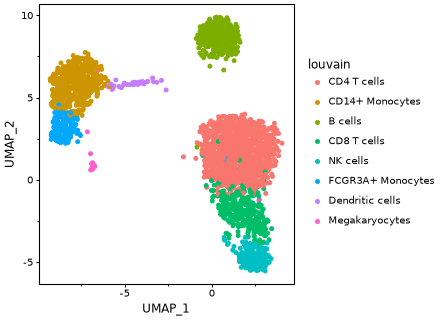

`gganndata` returns a `plotnine.ggplot`. It reads only the columns named in `aes(...)`. `plot.data` shows the exact table plotnine draws.

## What a name resolves to

A bare string is looked up in this order: an `obs` column, then a gene, then an `obsm` coordinate such as `UMAP_1`. An `obs` column wins over a gene of the same name, and ggann warns. Use a typed selector to say what you mean.

| You write | It reads |
|---|---|
| `"louvain"` or `obs("louvain")` | `adata.obs["louvain"]` |
| `"CD3D"` or `gene("CD3D")` | a gene from the plot-wide source |
| `gene("CD3D", use_raw=True)` | `adata.raw.X` |
| `gene("CD3D", layer="counts")` | `adata.layers["counts"]` |
| `obsm("umap", 0)` or `"UMAP_1"` | first column of `X_umap` |

With no source given, a gene comes from `.raw` when it exists, otherwise from `.X`. A `gene(...)` selector overrides that for its own gene only. `layer=` and `use_raw=True` cannot be combined.

```python
plot = gganndata(
    adata,
    aes(
        x=obsm("umap", 0),
        y=obsm("umap", 1),
        color=gene("CD3D", use_raw=True),
    ),
) + geom_point() + ag.theme_ggann()
```

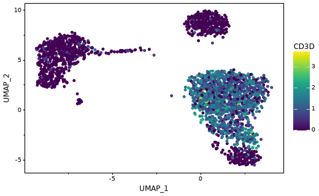

In `pbmc3k_processed`, `.X` holds only scaled highly variable genes, so `CD3D` needs `use_raw=True`. Cells with a missing group value drop out of grouped plots, with one warning that names the count. A `color=` field keeps its missing cells as `NA`, as in Scanpy.

## Helpers are shortcuts

A helper returns a ggplot. You can extend it with `+`. The grammar version gives the same figure with every choice visible.

::::{grid} 1 1 2 2

:::{grid-item-card} Helper
```python
helper = ag.plot_violin(
    adata, ["NKG7"], "louvain", use_raw=True, add_box=False
)
```
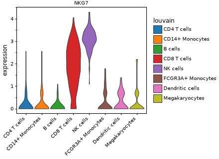
:::

:::{grid-item-card} Grammar
```python
from plotnine import element_text, geom_violin, theme

grammar = (
    gganndata(adata, aes("louvain", gene("NKG7", use_raw=True)))
    + geom_violin(scale="width")
    + ag.theme_ggann()
    + theme(axis_text_x=element_text(rotation=45, ha="right"))
)
```
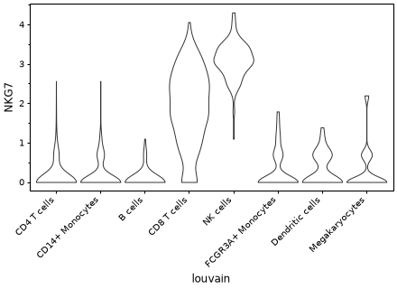
:::
::::

The helper adds the stored palette, a facet title and ordering. Add layers to it the same way:

```python
extended = helper + ag.stat_central_tendency()
```

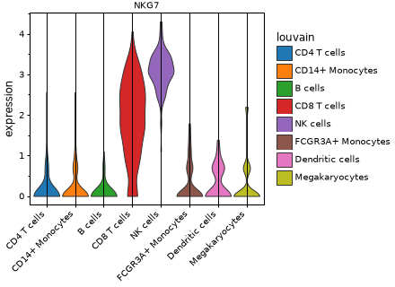

## Statistics layers

ggann re-exports the statistics layers of `plotnine-extra`. They draw the numbers and do not correct them. Every test treats cells as independent, so a p-value here ranks groups and does not estimate donor-level evidence. For donor-level claims, see the pseudobulk section.

| Layer | Use |
|---|---|
| `stat_compare_means` | Two groups, or one global test (Wilcoxon by default) |
| `stat_pwc` | All pairs, Holm-adjusted by default |
| `stat_cor` | Correlation label on a scatter |
| `stat_regline_equation`, `stat_kruskal_test`, `stat_anova_test` | Fit label and omnibus tests |
| `geom_signif`, `stat_pvalue_manual` | Brackets and p-values you computed |

```python
from plotnine import geom_boxplot, geom_jitter, geom_violin, scale_y_continuous

pair = adata[adata.obs["louvain"].isin(["CD4 T cells", "CD14+ Monocytes"])].copy()
pair.obs["louvain"] = pair.obs["louvain"].cat.remove_unused_categories()
stats_plot = (
    gganndata(pair, aes("louvain", gene("CD3D", use_raw=True)))
    + geom_violin()
    + ag.stat_compare_means(method="wilcox.test")
    + ag.theme_ggann()
)

pwc = (
    gganndata(
        adata[adata.obs["louvain"].isin(["CD4 T cells", "CD8 T cells", "NK cells"])],
        aes("louvain", gene("GNLY", use_raw=True)),
    )
    + geom_boxplot(outlier_shape="")
    + ag.stat_pwc(method="wilcox.test", label="p.adj.signif")
    + scale_y_continuous(expand=(0.05, 0, 0.2, 0))
    + ag.theme_ggann()
)

cor = (
    gganndata(adata, aes(gene("CD3D", use_raw=True), gene("CD8A", use_raw=True)))
    + geom_jitter(alpha=0.3, size=1, width=0.05, height=0.05)
    + ag.stat_cor(method="spearman", label_x_npc=0.4)
    + ag.theme_ggann()
)
```

::::{grid} 1 1 3 3
:::{grid-item}
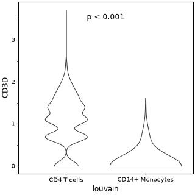
:::
:::{grid-item}
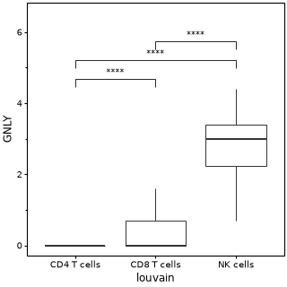
:::
:::{grid-item}
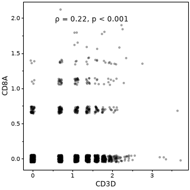
:::
::::

`plot_violin(..., stats=True)` and `plot_box(..., stats=True)` add one global test per gene without any layer.

## Pseudobulk

Donors are the replicates, and cells are the measurements. {func}`~ggann.pseudobulk` sums or averages cells to one profile per sample and group, and returns an `AnnData` that works with `gganndata`. It needs the `pseudobulk` extra (decoupler). Profiles built from fewer than `min_cells` cells (default 10) are dropped with a warning.

`pbmc3k` has one donor. The code below assigns cells to four random pseudo-donors, so the plot shows the layout and not biology. Real data has a `donor` column already. For raw integer counts, use `layer="counts"` and the default `mode="sum"`. Here `.raw` is log-normalised, so the call uses `mode="mean"` and `skip_checks=True`.

```python
import numpy as np
from plotnine import element_text, geom_jitter, theme

rng = np.random.default_rng(0)
adata.obs["donor"] = rng.choice(["D1", "D2", "D3", "D4"], adata.n_obs)
pb = ag.pseudobulk(
    adata,
    sample_col="donor",
    group_by="louvain",
    use_raw=True,
    mode="mean",
    min_cells=5,
    skip_checks=True,
)
plot = (
    gganndata(pb, aes("louvain", gene("NKG7", use_raw=False), color="donor"))
    + geom_jitter(width=0.15, height=0, size=2)
    + ag.theme_ggann()
    + theme(axis_text_x=element_text(rotation=45, ha="right"))
)
```

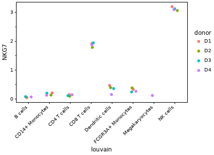

Each point is one donor. A test on these points compares donors. `pb.obs["psbulk_cells"]` holds the cell count behind each point.

## annplyr pipelines

ggann sits on [annplyr](https://github.com/mdmanurung/annplyr). `ap.tidy(adata)` gives an `AnnData` with dplyr-style verbs. Verbs that return an object feed `gganndata` and the helpers. Verbs that return a table (`summarize`, `count`, `to_wide`, `join_features`) feed plotnine directly. Name fields with selectors from `annplyr.data`: `obs.louvain`, `raw.CD3D`, `X.CST3`, `X_umap`.

A column made by `mutate` is an `obs` column, so it works as an aesthetic:

```python
tidy = ap.tidy(adata)
scored = tidy.filter(obs.percent_mito < 0.03).mutate(
    t_score=(raw.CD3D + raw.CD3E) / 2,
)
plot = (
    gganndata(scored, aes("UMAP_1", "UMAP_2", color="t_score"))
    + geom_point()
    + ag.theme_ggann()
)
```

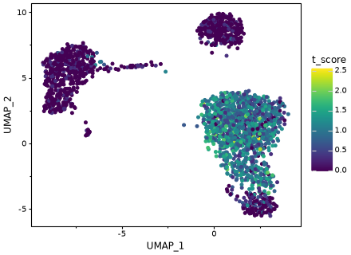

A grouped summary is a plain table:

```python
from plotnine import geom_col, ggplot

summary = tidy.summarize(
    mean_NKG7=ap.mean(raw.NKG7),
    by=obs.louvain,
    max_matrix_values=adata.n_obs,
)
plot = (
    ggplot(summary, aes("louvain", "mean_NKG7"))
    + geom_col()
    + ag.theme_ggann()
    + theme(axis_text_x=element_text(rotation=45, ha="right"))
)
```

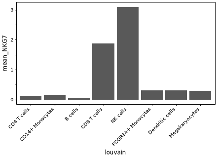

`to_wide` names columns as ggann does: genes keep their names and `X_umap` becomes `UMAP_1`, `UMAP_2`. `join_features(..., shape="long")` gives one dense row per cell and feature, with `.cell`, `.feature` and `.abundance_raw`. Both go straight into `ggplot(table, aes(...))`.

## Large and backed data

`gganndata` reads only the genes you map, so cost scales with `n_obs` times the number of mapped genes. Set `max_matrix_values` to make a too-large read an error instead of a stall. Expression and `obsm` values count against it. `obs` columns are free. Late fields added with `+` share the same budget.

```python
plot = gganndata(
    adata,
    aes("UMAP_1", "UMAP_2", color=gene("CD3D", use_raw=True)),
    max_matrix_values=3 * adata.n_obs,
) + geom_point()
```

A budget of `3 * adata.n_obs` covers two coordinates and one gene. A smaller budget raises `annplyr.AnnplyrError` before any read. The `plot_*` helpers limit width by the genes you request but have no hard budget. Backed `.h5ad` files and sparse matrices work with the same calls, and the plotted table is held in memory.
