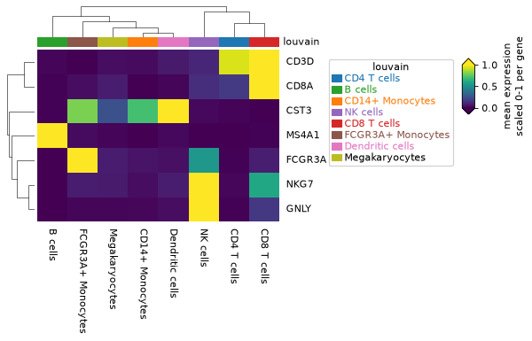
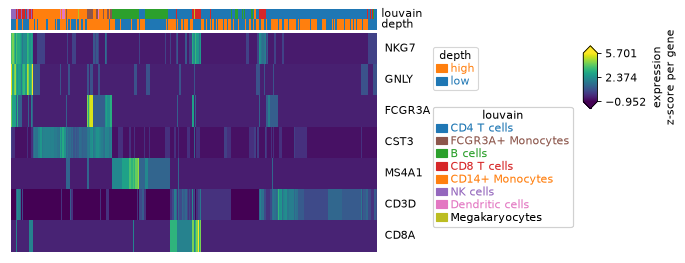
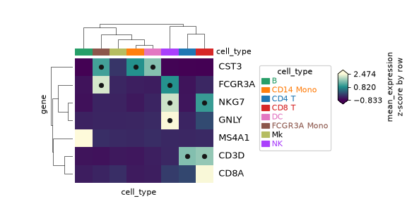
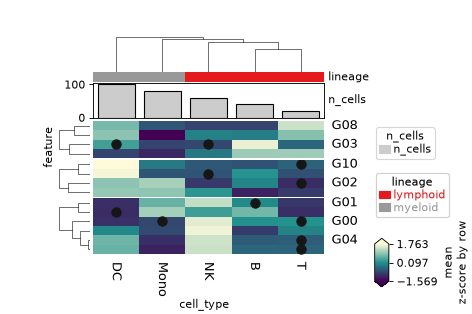
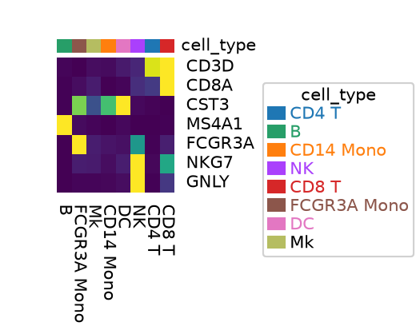
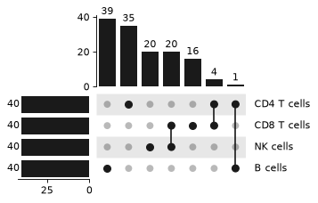

# Heatmaps and set plots

`plot_clustermap`, `tidy_heatmap` and `plot_upset` draw with PyComplexHeatmap or Marsilea. They return those backends' objects, not ggplots. The `+` operator, `compose` and `theme_*` do not apply to them.

```bash
pip install "ggann[heatmap]"   # plot_clustermap, tidy_heatmap
pip install "ggann[upset]"     # plot_upset
```

In Scanpy, `sc.pl.heatmap` shows one row per cell, with no gene dendrogram and no annotation bars on grouped means. These functions cluster genes and groups, draw the trees, and add annotation tracks. For a plain plotnine heatmap of group means, use `ag.plot_heatmap` (see {doc}`from_scanpy`).

All examples come from `examples/docs_figures/heatmaps.py` on `pbmc3k_processed`.

```python
import matplotlib.pyplot as plt
import numpy as np
import scanpy as sc
import ggann as ag

adata = sc.datasets.pbmc3k_processed()
MARKERS = ["CD3D", "CD8A", "NKG7", "GNLY", "MS4A1", "FCGR3A", "CST3"]
# a two-level obs column for the per-cell example (median split of n_counts)
adata.obs["depth"] = np.where(adata.obs["n_counts"] < adata.obs["n_counts"].median(), "low", "high")
```

The `short_ad` copy used below has shorter cluster names (`CD4 T`, `NK`, ...) so labels fit a narrow canvas. The script builds it. It keeps only the `cell_type` column in `obs`, because `tidy_heatmap` layers fail when a second per-group `obs` column sits next to the group key.

## Clustered group means

{func}`~ggann.plot_clustermap` averages genes per group, clusters both axes and adds a group annotation bar. Dendrograms are off by default: pass `row_dendrogram=True` and `col_dendrogram=True`. PyComplexHeatmap sizes the figure from the current matplotlib figure, so create it first.

```python
plt.figure(figsize=(5, 3.5))
cm = ag.plot_clustermap(
    adata,
    MARKERS,
    group_by="louvain",
    standard_scale="var",
    row_dendrogram=True,
    col_dendrogram=True,
)
plt.savefig("clustermap_groups.png", dpi=80, bbox_inches="tight")
```



Without `group_by`, columns are single cells. Pass `annotations=` to show `obs` columns as top bars.

```python
cells = adata[adata.obs.sample(300, random_state=0).index]
plt.figure(figsize=(6, 3.5))
cm = ag.plot_clustermap(
    cells,
    MARKERS,
    annotations=["louvain", "depth"],
    z_score=0,
    show_colnames=False,
)
```



Use either `standard_scale` (ggann, before clustering) or `z_score` (PyComplexHeatmap), not both. Cite PyComplexHeatmap (Ding et al., *iMeta* 2023, doi:10.1002/imt2.115).

## tidyHeatmap-style chaining

{func}`~ggann.tidy_heatmap` ports the verbs of R's tidyHeatmap. Each verb returns a new immutable `TidyHeatmap`. Nothing draws until `.draw()`, `.save()` or Jupyter display. The input is an `AnnData` (with `genes=`) or a long table (with `row=`, `column=`, `value=`).

From an AnnData, with `group_by` giving group means:

```python
heatmap = (
    ag.tidy_heatmap(
        short_ad,  # pbmc3k with shortened cluster names
        genes=MARKERS,
        group_by="cell_type",
        scale="row",
        show_colnames=False,  # the tile strip names the groups
    )
    .annotation_tile("cell_type")
    .layer_point("mean_expression > 1", size=2)
)
heatmap.save("tidy_adata", width="double-column", height=90, formats=("png",))
```



From a long table, with row splits, a bar annotation and significance dots:

```python
long_heatmap = (
    ag.tidy_heatmap(df, row="feature", column="cell_type", value="mean", scale="row")
    .annotation_tile("lineage")
    .annotation_bar("n_cells")
    .split_rows(3)
    .layer_point("padj < 0.05")
)
long_heatmap.save("tidy_long", width="double-column", height=100, formats=("png",))
```



Here `df` is the simulated table built in the script (14 features, 5 cell types, columns `mean`, `padj`, `lineage`, `n_cells`). Columns that are constant per row or per column become annotations automatically. Grouping with `df.groupby("lineage")` splits the columns.

| Verb | Does | Support vs R |
|---|---|---|
| `annotation_tile`, `annotation_point`, `annotation_bar`, `annotation_line` | Annotation track from one column | Full |
| `annotation_numeric` | Bar with the value printed | Partial |
| `annotation_group` | Group strip (one grouping per axis) | Partial |
| `layer_point`, `layer_square`, `layer_diamond`, `layer_star`, `layer_asterisk`, `layer_arrow_up`, `layer_arrow_down` | Symbol on cells that match a `query` string or callable | Full |
| `layer_text` | Text on matching cells (`label="stars"`) | Full |
| `split_rows(k)`, `split_columns(k)` | Cut the dendrogram into k blocks | Full |
| `get_heatmap_data()` | Matrix and row/column orders | Full |
| `as_ComplexHeatmap()` | The `ClusterMapPlotter` | Full |
| `a + b` | Place heatmaps side by side | Partial; needs identical rows |

Defaults differ from PyComplexHeatmap: clustering is `complete` with Euclidean distance (as in ComplexHeatmap), and `scale="row"` is a z-score that gives zeros, not NaN, when the standard deviation is 0. Extra keywords go to `ClusterMapPlotter`. Cite tidyHeatmap (Mangiola and Papenfuss, *JOSS* 2020, doi:10.21105/joss.02472) and PyComplexHeatmap.

## Export at journal size

PyComplexHeatmap leaves no room for tick labels or legends. {func}`~ggann.save_publication` and `TidyHeatmap.save` fix this: they draw at the export size, then shrink the heatmap body until labels and legends fit the canvas. The body stops shrinking at 20 mm and the function warns if something is still cut off. A `+` set (`TidyHeatmapSet`) is not fitted.

```python
plt.figure(figsize=(90 / 25.4, 70 / 25.4))
cm = ag.plot_clustermap(
    short_ad, MARKERS, group_by="cell_type", standard_scale="var", legend=False
)
ag.save_publication(
    cm, "export_single_column", width="single-column", height=70, formats=("png",)
)
```



Create the matplotlib figure at the target size first. The annotation and dendrogram proportions then stay as you set them. See {doc}`publication` for sizes, formats and `compose` (which rejects these objects).

## UpSet plot of shared markers

{func}`~ggann.plot_upset` takes a mapping of set name to members and draws the intersections with Marsilea. Build the sets from differential expression, for example the top 40 genes per cluster.

```python
sc.tl.rank_genes_groups(
    adata, "louvain", method="wilcoxon", n_genes=50, key_added="rank_wilcoxon"
)
de = ag.rank_genes_df(adata, key="rank_wilcoxon")
groups = ["CD4 T cells", "CD8 T cells", "NK cells", "B cells"]
sets = {g: de[de["group"] == g].head(40)["names"] for g in groups}
plt.figure(figsize=(6, 3.5))
up = ag.plot_upset(sets)
```



Bars are intersection sizes. Use `min_cardinality=` or `min_degree=` to drop small intersections. Marsilea adds no set-size axis title. Cite Marsilea (Zheng et al., *Genome Biol* 2025, doi:10.1186/s13059-024-03469-3).
