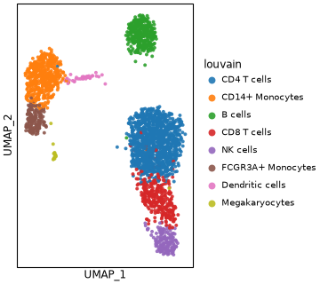
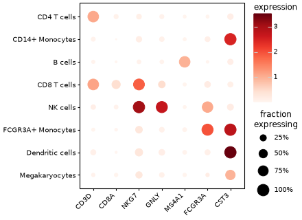
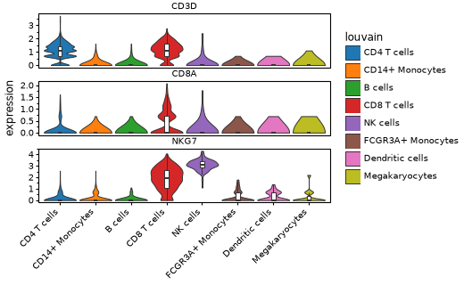

# ggann

ggann turns `AnnData` into plotnine graphics, so Scanpy users get ggplot-style single-cell figures with one call.

```python
import scanpy as sc
import ggann as ag

adata = sc.datasets.pbmc3k_processed()
markers = ["CD3D", "CD8A", "NKG7", "GNLY", "MS4A1", "FCGR3A", "CST3"]

ag.plot_embedding(adata, "umap", color="louvain")
ag.plot_dotplot(adata, markers, "louvain")
ag.plot_violin(adata, markers[:3], "louvain")
```

Each call returns a `plotnine.ggplot`. Add layers with `+`, or save it with `.save()`.

::::{grid} 1 1 3 3
:gutter: 1

:::{grid-item}

:::

:::{grid-item}

:::

:::{grid-item}

:::

::::

## Install

ggann needs [`annplyr`](https://github.com/mdmanurung/annplyr)
`>=0.5,<0.6` and [`plotnine-extra`](https://github.com/mdmanurung/plotnine-extra)
`>=0.3.1,<0.4`. Neither release is on PyPI yet, so `pip install ggann` does not
resolve today. The package metadata does not use Git commit URLs, so install the
two dependencies from GitHub first, at the commits CI tests against:

```bash
pip install "annplyr @ git+https://github.com/mdmanurung/annplyr@ae2db5402c8b1c714bb12906ff82a40fbb0d8de2"
pip install "plotnine-extra @ git+https://github.com/mdmanurung/plotnine-extra@fcbd88f64760a2dd6e8200028a1a00909aa2c9f8"
pip install "ggann @ git+https://github.com/mdmanurung/ggann"
```

Once ggann 0.1.0 is released and both dependencies are on PyPI, one command
will do:

```bash
pip install ggann
```

ggann requires Python 3.12 or later. The core install also pulls in
[plotnine](https://plotnine.org/), Scanpy and AnnData.

### Optional extras

| Extra | Functions | Backend |
|---|---|---|
| `density` | {func}`~ggann.plot_density` | [pyNebulosa](https://github.com/mdmanurung/pyNebulosa) |
| `upset` | {func}`~ggann.plot_upset` | [marsilea](https://marsilea.readthedocs.io/) |
| `heatmap` | {func}`~ggann.plot_clustermap`, {func}`~ggann.tidy_heatmap` | [PyComplexHeatmap](https://github.com/DingWB/PyComplexHeatmap) |
| `pseudobulk` | {func}`~ggann.pseudobulk` | [decoupler](https://decoupler-py.readthedocs.io/) |

```bash
pip install "ggann[density,upset,heatmap,pseudobulk]"
```

A function called without its backend raises an `ImportError` that names the extra.

## Where to go next

::::{grid} 1 1 2 3
:gutter: 2

:::{grid-item-card} Coming from Scanpy
:link: from_scanpy
:link-type: doc
:class-card: sd-border-primary

**Start here if you use Scanpy.** Every `sc.pl.*` call next to its ggann equivalent.
:::

:::{grid-item-card} Custom figures
:link: grammar
:link-type: doc

Build your own plots with `gganndata`, plotnine layers, stats and pseudobulk.
:::

:::{grid-item-card} Publication figures
:link: publication
:link-type: doc

Set exact sizes, styles and palettes, compose panels and export.
:::

:::{grid-item-card} Heatmaps and UpSet
:link: heatmaps
:link-type: doc

Clustermaps, tidy heatmaps and UpSet plots.
:::

:::{grid-item-card} API reference
:link: api
:link-type: doc

Every public function, with an example image.
:::

:::{grid-item-card} Notes
:link: notes
:link-type: doc

Known limits, performance numbers and how to cite.
:::

::::

```{toctree}
:maxdepth: 1
:hidden:

from_scanpy
grammar
publication
heatmaps
notes
api
```
