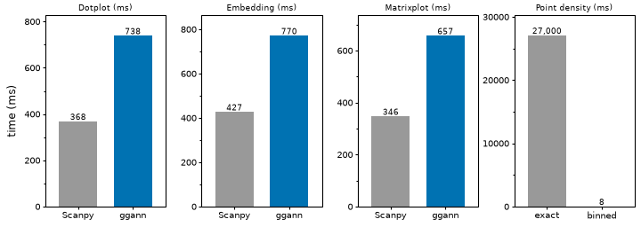

# Notes

This page lists known limits, performance numbers and how to cite ggann.

## Limitations

Each item names the limit, then what to do. Items marked "upstream" come from plotnine or plotnine-extra.

**Embeddings and features**

- `plot_embedding` has no 3-D view, `edges`, `arrows` or array `size` → plot two `components=`, or add plotnine layers and a `theme()`.
- `backend="matplotlib"` rejects `components`, `palette`, `groups`, `split_by` and dict `genes` → use the plotnine backend.
- Exact point density is slow (27 s at 20,000 cells) → use `method="binned"`, `pointdensity=False` or `downsample=`.
- `plot_features` with an obs column returns a composition, not one `ggplot` → pass `color_scale="shared"`, but a shared scale mixes units.

**Dotplot, matrixplot, heatmap and DE**

- No `dendrogram=` on `plot_dotplot`, `plot_matrixplot` or `plot_heatmap` → set `categories_order=`, or use `plot_clustermap` or `plot_dendrogram`.
- `coord_flip()` reverses category order → use `swap_axes=True`.
- `plot_rank_genes_*` does not take negative `n_genes` → sort the DE table and pass the genes to `plot_dotplot`.
- `plot_correlation` correlates mean gene profiles, Scanpy uses PCA space → pass `use_rep="X_pca"` to match Scanpy.

**Distributions and statistics**

- `stat_sina` jitters integer data (upstream) → use `plot_violin` or `plot_box` for counts.
- `stat_compare_means(comparisons=)` and `geom_signif(comparisons=)` fail (upstream) → use the global test or `ggann.stat_pwc`.
- The Wilcoxon label is SciPy's asymptotic p-value, so it differs from R's exact test below n = 50 → state the test in the legend.

**Grammar and export**

- Helper outputs (`plot_embedding`, `plot_features`) do not take late `+ aes(...)` or `+ facet_*(...)` → use `split_by=`, or build the plot with `gganndata`.
- `plotnine.ggsave` and `Wrap.save` fail on compositions (upstream) → use `ggann.compose(...).save(...)` or `save_publication`.
- `compose` rejects clustermap and UpSet results → export them alone and combine the files outside ggann.
- `save_publication` never crops or enlarges the canvas, and stops shrinking a heatmap body at 20 mm → shorten labels, hide legends or widen the canvas.
- Only the first eight qualitative colours are measured under colour-vision simulation, and export writes SVG, PDF, PNG and TIFF only → add labels or shapes beyond eight categories; convert `.jpg` or `.eps` outside ggann.

## Performance

ggann is slower than Scanpy on the measured plots, so pick it for the grammar and the export, not for speed. The matched benchmark gate (end to end at least 0.91x of Scanpy) is **not met**: the three primary workloads run at 0.50x to 0.55x.

The plot below uses the numbers in these tables. It was drawn with ggann (`gganndata` with `geom_col`) by `examples/docs_figures/index_notes.py`.



**Matched Scanpy benchmark.** 20,000 cells, 10,000 genes, 32 genes, 32 groups, CSR `.X`, median of 7 warm runs. Measured on a 24-core Intel Xeon E5-2690 v3 with Scanpy 1.12.3, annplyr 0.3.0 and plotnine 0.15.7, before the 0.1.0 readiness changes.

| Workload | ggann end to end | Scanpy end to end | Scanpy / ggann | ggann peak RSS | Scanpy peak RSS |
|---|---:|---:|---:|---:|---:|
| Embedding | 770.4 ms | 426.7 ms | 0.55x | 29.09 MiB | 5.60 MiB |
| Dotplot | 738.0 ms | 367.9 ms | 0.50x | 17.00 MiB | 12.12 MiB |
| Matrixplot | 656.7 ms | 346.5 ms | 0.53x | 17.16 MiB | 7.73 MiB |

Most of the time goes to plotnine and Matplotlib drawing, which is the cost of keeping an ordinary, composable `ggplot`. No benchmark plot drops cells or downsamples.

**Measured on `res-hpc-exe048` (Intel Xeon E5-2690 v3), 2026-11-01.** Four other jobs shared the node, so treat these as rough. Compare a before and after pair only within its row.

| Change | Cells | Before | After |
|---|---:|---:|---:|
| `plot_tracksplot` draws `geom_rect`, not `geom_col` | 700 | 6.12 s | 0.52 s |
| `plot_tracksplot` draws `geom_rect`, not `geom_col` | 2,800 | 22.89 s | 0.99 s |
| Point density, exact KDE vs `method="binned"` | 700 | 0.46 s | 0.001 s |
| Point density, exact KDE vs `method="binned"` | 20,000 (synthetic) | 27 s | 0.008 s |

Binned density tracks the exact values closely (Spearman 0.9999 on PBMC, 1.0000 on the synthetic set; max normalised error 0.031 and 0.016). The legend reads `density (binned)`. `save_publication` takes 0.26 s to 0.44 s for one format on a 700-cell plot at 89 x 70 mm and 300 dpi.

**Reproduce.** Run from the repository root. The first command is a quick check, not evidence for a speed claim.

```bash
PYTHONPATH=src python benchmarks/compare_scanpy.py \
  --preset smoke --formats csr --workloads primary --sources x \
  --repeats 2 --seed 20260809 \
  --output /tmp/ggann-vs-scanpy-smoke.json --report /tmp/ggann-vs-scanpy-smoke.md
```

For the full primary result use `--preset extended --repeats 7 --include-cold-start` on a quiet machine with one BLAS thread. Density timings come from `benchmarks/validate_point_density.py`. The raw samples are in `benchmarks/results/scanpy-extended-csr.json`.

## Citing

Cite ggann with the metadata in `CITATION.cff` (GitHub's "Cite this repository" button gives BibTeX). Cite the version you used, and the tools that computed what the figure shows.

```text
Manurung, M. ggann: a grammar of graphics for AnnData (version 0.1.0).
https://github.com/mdmanurung/ggann
```

Get the version with `importlib.metadata.version("ggann")`.

| Cite | When | Reference |
|---|---|---|
| AnnData | Always | Virshup I, Rybakov S, Theis FJ, Angerer P, Wolf FA. anndata: access and store annotated data matrices. *JOSS* 9, 4371 (2024). doi:10.21105/joss.04371 |
| Scanpy | Always | Wolf FA, Angerer P, Theis FJ. SCANPY: large-scale single-cell gene expression data analysis. *Genome Biol* 19, 15 (2018). doi:10.1186/s13059-017-1382-0 |
| plotnine | Always | Kibirige H et al. plotnine: a grammar of graphics for Python. Zenodo, doi:10.5281/zenodo.1325308 (cite the version DOI you used) |
| SciPy | You show `stat_cor`, `stat_compare_means` or `stat_regline_equation` | Virtanen P et al. SciPy 1.0: fundamental algorithms for scientific computing in Python. *Nat Methods* 17, 261–272 (2020). doi:10.1038/s41592-019-0686-2 |
| decoupler | You use `pseudobulk` | Badia-i-Mompel P et al. decoupleR: ensemble of computational methods to infer biological activities from omics data. *Bioinformatics Advances* 2, vbac016 (2022). doi:10.1093/bioadv/vbac016 |
| PyComplexHeatmap | You use `plot_clustermap` or `tidy_heatmap` | Ding W, Goldberg D, Zhou W. PyComplexHeatmap: a Python package to visualize multimodal genomics data. *iMeta* 2, e115 (2023). doi:10.1002/imt2.115 |
| tidyHeatmap | You use `tidy_heatmap` (API design) | Mangiola S, Papenfuss AT. tidyHeatmap: an R package for modular heatmap production based on tidy principles. *JOSS* 5, 2472 (2020). doi:10.21105/joss.02472 |
| Nebulosa | You use `plot_density` | Alquicira-Hernandez J, Powell JE. Nebulosa recovers single-cell gene expression signals by kernel density estimation. *Bioinformatics* 37, 2485–2487 (2021). doi:10.1093/bioinformatics/btab003 |
| Marsilea | You use `plot_upset` | Zheng Y, Zheng Z, Rendeiro AF, Cheung E. Marsilea: an intuitive generalized paradigm for composable visualizations. *Genome Biol* 26, 5 (2025). doi:10.1186/s13059-024-03469-3 |

State in your methods the expression source (`.X`, `.raw` or a layer), the statistic each panel shows, the test and correction behind any p-value, that donors are the replicates for pseudobulk, and the `random_state` of any downsampling.
