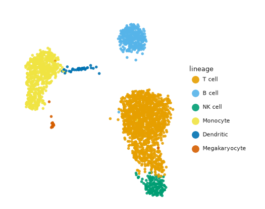
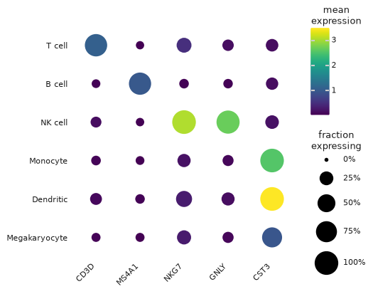
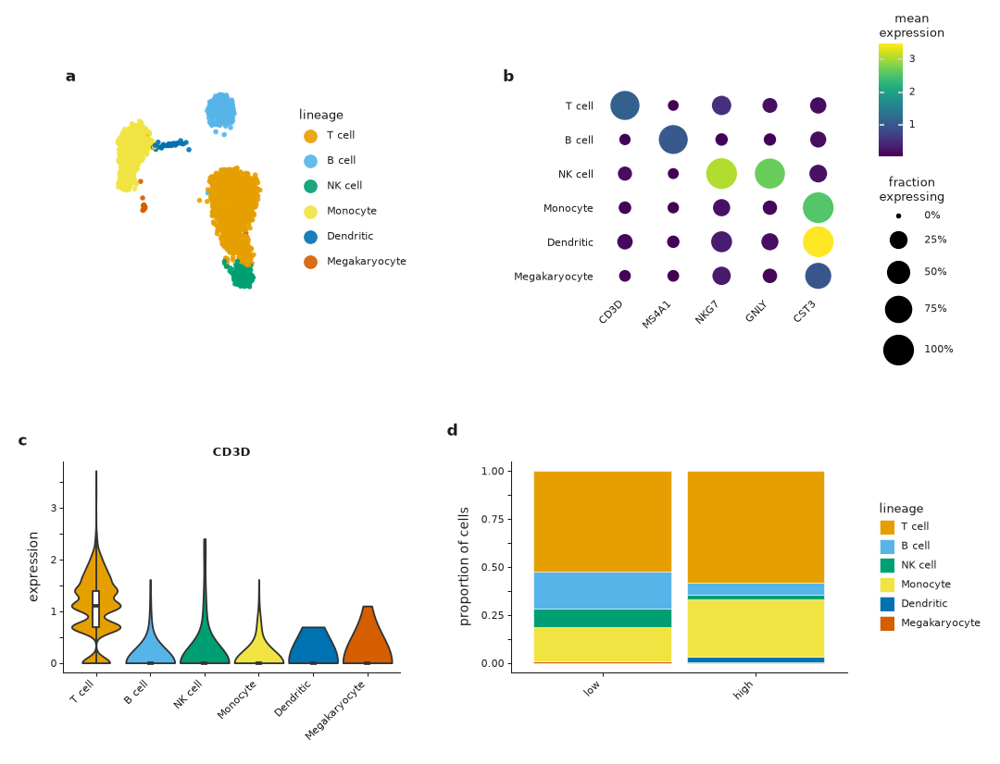

# Publication figures

In Scanpy you set `rcParams` and `figsize`, call `save=`, then fix sizes and fonts in Illustrator. In ggann you pick a journal width in millimetres. {func}`~ggann.save_publication` writes exactly that canvas, with editable SVG text. Nothing is cropped or rescaled.

The presets are generic starting points. Check your journal's current width, font and format rules before you submit.

| Task | Scanpy | ggann |
|---|---|---|
| Set fonts and sizes | `sc.set_figure_params(...)`, `rcParams` | {func}`~ggann.style_context` |
| Set the canvas | `figsize` in inches, then resize by hand | `width="single-column"`, `height=70` (mm) |
| Save | `save="_fig.pdf"` (tight-cropped) | {func}`~ggann.save_publication` (exact size) |
| Panel tags | draw in Illustrator | {func}`~ggann.compose` `tag_levels="auto"` |

## One figure at 89 mm

Build the plot inside `style_context`, then save it with a width and a height. The PNG below is the file `save_publication` wrote, at its true 89 x 70 mm size.

```python
import ggann as ag

with ag.style_context("single-column"):
    umap = ag.plot_embedding(adata, "umap", color="lineage", size=1.0)
ag.save_publication(
    umap, "single_column.png", width="single-column", height=70, dpi=150
)
```



`height` is required, in `units` (default `"mm"`). Use `width="double-column"` for 183 mm, or a number for any other width. A bare stem such as `"figure_1"` writes SVG, PDF and PNG. A suffix such as `"figure_1.png"` writes only that format.

Outside `style_context`, helpers keep their exploratory look. You can also add the theme to any plot with `+ ag.theme_publication(axes="embedding")`. The `axes` value is one of `"standard"`, `"embedding"`, `"matrix"` or `"distribution"`.

Override the preset with {func}`~ggann.publication_style`:

```python
style = ag.publication_style("double-column", base_size=7, tag_size=8.5)
with ag.style_context(style):
    ...
```

## Palettes

Scanpy stores colours in `adata.uns["<col>_colors"]`. ggann reuses them, so a plot matches `sc.pl.umap`. In publication mode ggann keeps the stored palette only when it has one valid colour per category. Otherwise it falls back to a fixed accessible palette and warns if the stored colours were invalid. It never edits `adata.uns` for you.

{func}`~ggann.publication_palette` gives that accessible palette. Store it once and every panel shares it.

```python
order = ["T cell", "B cell", "NK cell", "Monocyte", "Dendritic", "Megakaryocyte"]
genes = ["CD3D", "MS4A1", "NKG7", "GNLY", "CST3"]
palette = ag.publication_palette("qualitative", categories=order)
adata.uns["lineage_colors"] = list(palette.values())
with ag.style_context("single-column"):
    dots = ag.plot_dotplot(adata, genes, group_by="lineage", use_raw=True)
ag.save_publication(
    dots, "palette_dotplot.png", width="single-column", height=70, dpi=150
)
```



The first eight colours pass distance checks for normal vision, grayscale and three colour-vision simulations. Colours extend in a fixed order, so adding a category never recolours the earlier ones. Past eight, separation is not guaranteed, and ggann warns once. Add direct labels or facets for those figures.

The same call takes `"sequential"` and `"diverging"` with `n=`. An explicit `cmap=` on a helper beats the style's sequential map.

## Several panels

{func}`~ggann.compose` lays out plots with relative widths, a gap in millimetres and automatic bold tags. It returns a plotnine `Compose`, so `save_publication` and `.save` both work.

```python
from plotnine import theme

with ag.style_context("double-column"):
    panels = [
        ag.plot_embedding(adata, "umap", color="lineage", size=1.0),
        ag.plot_dotplot(adata, genes, group_by="lineage", use_raw=True),
        ag.plot_violin(adata, ["CD3D"], group_by="lineage", use_raw=True)
        + theme(legend_position="none"),
        ag.plot_proportions(adata, group_by="lineage", split_by="depth"),
    ]
    figure = ag.compose(
        panels, ncol=2, widths=(0.95, 1.25), gap=2, tag_levels="auto"
    ) + theme(legend_position="right")
ag.save_publication(
    figure, "four_panels.png", width="double-column", height=140, dpi=150
)
```



Set tags with `tag_levels` (`"auto"`, `"A"`, `"a"`, `"1"`, `"i"`). Use `guides="collect"` to drop a later legend only when it matches an earlier one exactly. Plots keep the style they were built with, so you can save outside the `with` block.

`save_publication` warns when text, a legend or a colourbar leaves the canvas, and names the items and the overshoot in millimetres. It does not resize anything. Fix the figure and export again. The first draft of the figure above overflowed at 120 mm, so the height is 140.

## Rasterize, fonts, formats

Rasterize only the dense data layer. Text, axes, legends and tags stay vector.

- **Dense points and tiles:** pass `rasterized=True` to {func}`~ggann.plot_embedding` or {func}`~ggann.plot_matrixplot`. The SVG then holds one embedded image for the data and live text for every label.
- **Fonts:** Arial, then Helvetica, then DejaVu Sans. If Arial is missing, ggann warns once and Matplotlib uses DejaVu Sans. SVG text stays editable. PDFs embed the font actually used (Type 42).
- **Text sizes:** 5.5 to 7 pt, tags 8 pt, main lines 0.5 pt.
- **Matrix labels:** `annotate="auto"` prints a cell value only when the cell is at least 12 pt wide and high at the final size.

| Format | Use | Notes |
|---|---|---|
| `svg` | editing in Illustrator or Inkscape | text stays text |
| `pdf` | journal upload | embedded Type 42 fonts |
| `png` | drafts, slides | pixels are `floor(inches x dpi)`, so 89 mm at 150 dpi is 525 px |
| `tiff` | print journals | same rule as PNG |

`dpi` takes any positive integer and defaults to 600. `.jpg` and `.eps` raise an error. `background` accepts `"white"`, `"transparent"` or any Matplotlib colour. Request several formats at once with `formats=("svg", "pdf", "png", "tiff")`.

Before you submit, open the SVG or PDF at the submitted size. Check that every panel states its `n` and that the legend defines each centre, interval and test.

## Heatmaps

`save_publication` also exports {func}`~ggann.plot_clustermap` and {func}`~ggann.plot_upset`, and it shrinks a PyComplexHeatmap body until every label and legend fits the canvas. See {doc}`heatmaps`.
