# Scanpy parity

Parity means that a pair represents the same cells, variables, groups, and
summary statistic. It does not mean pixel identity: Scanpy and ggann use
different plotting systems.

Each pair renders the Scanpy call and the ggann call on the same
`pbmc3k_processed` object, so any visual difference comes from the plotting
system rather than from the data.

## Supported calls

Each section names the ggann helper, the Scanpy keywords it accepts (ggann
spelling), the Scanpy keywords it does not accept, and the grammar equivalent
where one exists. A keyword that is not listed as accepted raises `TypeError`.
Every helper with `group_by=` also accepts Scanpy's `groupby=`; giving both with
different values raises `TypeError`.

Defaults follow Scanpy: rank-genes plots use `n_genes=10`, matrixplots use raw
group means (`standard_scale=None`), `plot_variance_ratio` uses
`n_pcs=30, log=False`, and `plot_highest_expr_genes` shows 30 genes.
Dotplots and matrixplots draw the first category at the top, as Scanpy does.

### Not supported: `show`, `return_fig`, `save`, `ax`

ggann helpers return a plot and draw nothing. These four keywords therefore do
not exist. Each has a composable equivalent:

| Scanpy | ggann |
|---|---|
| `show=True` | display the returned object, or call `plot.draw()` for a Matplotlib figure |
| `return_fig=True` | the call already returns the plot |
| `save="x.png"` | `plot.save("x.png", width=, height=, dpi=)` |
| `ax=ax` | `ag.compose([plot_a, plot_b], ncol=2)` |

```python
plot = ag.plot_dotplot(adata, genes, group_by="louvain")
fig = plot.draw()  # Matplotlib Figure; nothing is shown until you ask
ag.save_publication(
    plot, "dotplot", width="single-column", height=70, formats=("svg", "png")
)
umap = ag.plot_embedding(adata, "umap", color="louvain")
figure = ag.compose([umap, plot], ncol=2)
```

`ag.save_publication` writes exact-size SVG, PDF, PNG and TIFF from one object.
`ag.compose` replaces a shared `ax` or a Matplotlib subplot grid.

### `sc.pl.umap`, `sc.pl.embedding`, `sc.pl.pca`, `sc.pl.tsne`

Helper: `plot_embedding` (`basis="umap"`, `"pca"`, `"tsne"`, or any `obsm` key).
`plot_features` draws one panel per feature.

- Accepted: `basis`, `color` (one name or a list, one panel per name),
  `components`, `layer`, `use_raw`, `palette`, `color_map`, `vmin`, `vmax`,
  `vcenter` (numbers or `"p99"`; values clip), `groups`, `sort_order`,
  `na_color`, `title`, `legend_loc` (`"right margin"`, `"right"`, `"on data"`,
  `"none"`), `size` (one number), `alpha`, `ncol`. ggann adds `split_by`,
  `label`, `pointdensity` and `downsample`.
- Not supported: `projection` (no 3-D), `edges`, `arrows`, `add_outline`,
  `frameon`, `legend_fontsize`, `legend_fontweight`, and `size` as an array.
- The Matplotlib backend rejects `components` through `legend_loc` with
  `ValueError`. Use the default plotnine backend for them.
- Grammar: `vmin`/`vmax` is `scale_color_gradient(limits=..., oob=squish)`;
  `groups` is a manual colour scale with `na_value` after blanking the other
  categories; `title` is `labs(title=...)`; `legend_loc="none"` is
  `theme(legend_position="none")`. All four run in
  `embedding_vmin_vmax_grammar`, `embedding_groups_grammar`,
  `embedding_title_grammar` and `embedding_legend_none_grammar` in
  `examples/grammar_equivalents.py`.

### `sc.pl.scatter`

Helper: `plot_qc_scatter` for two `obs` fields or genes. Use `plot_embedding`
for `basis=`.

- Accepted: `x`, `y`, `color`, `layer`, `use_raw`. ggann adds `size`, `alpha`
  and `log` (log10 axes; non-positive values raise instead of being dropped).
- Not supported: `basis`, `groups`, `components`, `palette`, `legend_loc`,
  `projection`.
- Grammar: `gganndata(adata, aes(x, y, color=...)) + geom_point()`.

### `sc.pl.violin`

Helper: `plot_violin`.

- Accepted: `keys` as `genes` (gene names or numeric `obs` columns), `groupby`,
  `use_raw`, `layer`, `log` (draws `log1p`; zeros stay), `order`, `rotation`,
  `scale`, `stripplot` as `add_points`, and `jitter_size` / `jitter_alpha`.
  Panels are always one facet per gene (`ncol=`), so `multi_panel` has no switch.
- Not supported: `ax`, `jitter` as a width, `size`, `xlabel` and `ylabel` (use
  `labs`).
- Grammar: `violin_grammar` in `examples/grammar_equivalents.py`.

### `sc.pl.stacked_violin`

Helper: `plot_stacked_violin`.

- Accepted: `var_names` as `genes`, `groupby`, `use_raw`, `layer`, `log`,
  `order`, `rotation`, `swap_axes`, `stripplot`, `yticklabels`, `cmap`, `scale`.
- Not supported: `dendrogram`, `var_group_positions`,
  `standard_scale`, `row_palette`, `colorbar_title`, `figsize`, a dict of marker
  groups.
- Groups are rows and genes run along x, as in Scanpy's default; `swap_axes=True`
  transposes both. Each violin is filled by the group's median
  expression with one shared colour bar (`cmap="Blues"`), as in Scanpy. Rows
  have no y tick labels unless `yticklabels=True`.
- Grammar: the violin recipe with `facet_grid("feature ~ .", scales="free_y")`
  and `fill` mapped to the group median ({doc}`comparisons`).

### `sc.pl.dotplot`

Helper: `plot_dotplot`.

- Accepted: `var_names` as `genes` (a list, or a `{marker group: [genes]}` dict
  with one panel per group), `groupby`, `use_raw`, `layer`, `standard_scale`
  (`"var"`, `"group"`; ggann adds `"zscore"`), `expression_cutoff`, `cmap`,
  `vmin`, `vmax`, `dot_min`, `dot_max`, `swap_axes`, `categories_order`. ggann
  adds `split_by`, `size_range` and `annotate`.
- Not supported: `dendrogram`, `var_group_rotation`, `smallest_dot` and
  `largest_dot` (use `size_range`, in plotnine size units), `mean_only_expressed`,
  `vcenter`, `gene_symbols`, `colorbar_title`, `size_title`.
- A repeated gene in the dict appears once per occurrence, labelled by group.
  The dict needs the plotnine backend.
- Use `swap_axes=True`, not `coord_flip()`: a flip reverses the displayed order.
- Grammar: `dotplot_grammar`.

### `sc.pl.matrixplot`

Helper: `plot_matrixplot`.

- Accepted: `var_names` as `genes` (list or dict), `groupby`, `use_raw`, `layer`,
  `standard_scale`, `cmap`, `vmin`, `vmax`, `swap_axes`, `categories_order`.
  ggann adds `split_by` and `annotate`.
- Not supported: `dendrogram`, `var_group_rotation`, `vcenter`, `gene_symbols`,
  `colorbar_title`. A matrixplot has no detection threshold, so
  `expression_cutoff` does not apply.
- Default scaling: both libraries colour raw group means
  (`standard_scale=None`). Earlier ggann builds scaled rank-genes matrixplots per
  gene by default; they no longer do. Pass `standard_scale="var"` to rescale each
  gene to `[0, 1]` across groups in either library. `"zscore"` is ggann only and
  switches to a zero-centred `RdBu_r` map.
- Grammar: `matrixplot_grammar`.

### `sc.pl.heatmap`

Helper: `plot_heatmap` (one tile column per retained cell; cells keep their
input order within a group).

- Accepted: `var_names` as `genes` (list or dict), `groupby`, `use_raw`, `layer`,
  `cmap`, `vmin`, `vmax`, `swap_axes`, `standard_scale`. ggann adds `downsample`
  and `annotate`.
- Not supported: `dendrogram`, `show_gene_labels`, `var_group_rotation`,
  `vcenter`, `gene_symbols`.
- Grammar: `ggplot + geom_tile` over the per-cell long table ({doc}`comparisons`).

### `sc.pl.tracksplot`

Helper: `plot_tracksplot`.

- Accepted: `var_names` as `genes` (a list, or a `{label: [genes]}` dict with
  tracks titled `gene [label]`), `groupby`, `use_raw`, `layer`. ggann adds
  `categories_order`.
- Not supported: `dendrogram`, `log`, `gene_symbols`, `figsize`.
- Grammar: `ggplot + geom_rect + facet_grid` over the per-cell long table.

### `sc.pl.rank_genes_groups_dotplot` and `..._matrixplot`

Helpers: `plot_rank_genes_dotplot`, `plot_rank_genes_matrixplot`.

- Accepted: `n_genes` (positive integer), `groupby`, `key`, `groups`,
  `min_logfoldchange`, `values_to_plot` (`scores`, `logfoldchanges`, `pvals`,
  `pvals_adj`, `log10_pvals`, `log10_pvals_adj`), and the dotplot or matrixplot
  options above through `**kwargs`. The matrixplot also takes `standard_scale`.
- `values_to_plot` draws the stored DE statistic, never an expression mean. It
  needs a result stored with `n_genes=adata.n_vars` and cannot be combined with
  `standard_scale`.
- Not supported: negative `n_genes` (bottom-ranked genes), marker brackets
  (`var_group_positions`), `dendrogram`, `gene_symbols`.
- A gene that is a top marker of several groups gets one column per marker
  group, labelled `GENE (group)`, where Scanpy draws one column inside brackets.
- Grammar: `rank_genes_df`, then the dotplot or matrixplot recipe.

### `sc.pl.highest_expr_genes`

Helper: `plot_highest_expr_genes`.

- Accepted: `n_top` (or `n`; giving both with different values raises), `layer`,
  `gene_symbols`, `log` (draws `log1p(percent)`). ggann adds `use_raw`.
- Not supported: extra Matplotlib `boxplot` keywords.
- The default is 30 genes, as in Scanpy.
- Grammar: `ggplot + geom_boxplot` over per-cell percentages.

### `sc.pl.pca_variance_ratio`

Helper: `plot_variance_ratio`.

- Accepted: `n_pcs` (default 30), `log` (default `False`), `key`.
- Grammar: `ggplot + geom_point + geom_line`.

### `sc.pl.dendrogram`

Helper: `plot_dendrogram`.

- Accepted: `groupby`, `dendrogram_key` as `key`, `orientation` (`"top"` and
  `"left"`).
- Not supported: the `"bottom"` and `"right"` orientations.
- Stored `sc.tl.dendrogram` coordinates are reused. Missing ones are computed on
  a temporary copy, so `adata` is not changed.
- Grammar: `ggplot + geom_path` over the link coordinates.

### `sc.pl.correlation_matrix`

Helper: `plot_correlation`.

- Accepted: `groupby`, `show_correlation_numbers` as `annotate`, `cmap`. ggann
  adds `genes`, `layer`, `use_raw`, `method`, `cluster`, `use_rep` and `n_pcs`.
- Not supported: `figsize`, `dendrogram` (use `cluster=True`, the default).
- The statistic differs by default. `plot_correlation` correlates group-mean
  gene profiles over the highly variable genes (or `genes=`). Scanpy correlates
  group means of the PCA embedding. Pass `use_rep="X_pca"` (and optionally
  `n_pcs`) to reproduce Scanpy. `use_rep` cannot be combined with `genes`,
  `layer` or `use_raw`.
- Scanpy needs `sc.tl.dendrogram` first. ggann does not.
- Grammar: `correlation_grammar` in `examples/grammar_equivalents.py`.

## Other helpers

These have no single Scanpy plotting counterpart:

| ggann | Closest construction |
|---|---|
| `plot_embedding_density` | `sc.pl.embedding_density`; ggann computes the KDE itself, so `key=` is not supported |
| `plot_clustermap` | `sc.pl.clustermap`; grid backend, draws no dendrogram unless `row_dendrogram=True` or `col_dendrogram=True` |
| `plot_density` | Compute feature density, then `sc.pl.embedding`-style scatter |
| `plot_box`, `plot_sina`, `plot_ridge` | Extract expression, then Matplotlib/seaborn distribution plot |
| `plot_expression_bar`, `plot_expression_line` | Aggregate expression, then Matplotlib line/bar plot |
| `plot_proportions` | `adata.obs` crosstab followed by a bar/area/line plot |
| `plot_volcano`, `plot_ma` | Plot a differential-expression result table |
| `plot_upset` | External set-intersection backend |

`sc.pl.paga` and graph-layout visualizations are not implemented. Use Scanpy
for those workflows.

## Source and ordering semantics

- Both libraries default to `.raw` when it exists and no layer is selected.
- In ggann, `use_raw=False` forces `.X`; `layer="name"` selects a named layer.
- ggann preserves categorical `obs` order. `categories_order=` must cover all
  observed non-missing groups and drops unused levels.
- Cells with a missing `group_by` value are dropped from grouped plots, with one
  `UserWarning` giving the count.
- Downsampling is never silent. `downsample=` is deterministic by default with
  `random_state=0`.

## Rendered comparisons

The committed images were generated by `examples/reproduce_scanpy.py` from one
`pbmc3k_processed` object. They are visual references, not performance evidence.
One pair uses a non-default option so that both sides show the same statistic:
ggann's correlation uses `use_rep="X_pca"`. Both matrixplots show raw group means. The
ggann tracksplot is drawn wider (8 in) to reduce label overlap; the labels of
the two smallest groups still touch.

### Embedding and feature panels

| Scanpy | ggann |
|:---:|:---:|
| 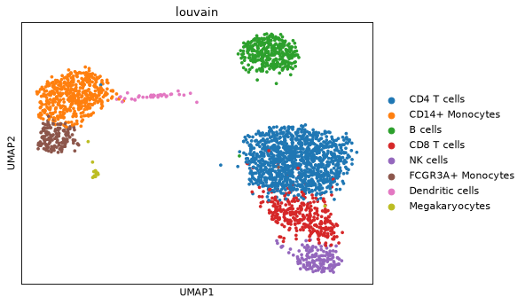 | 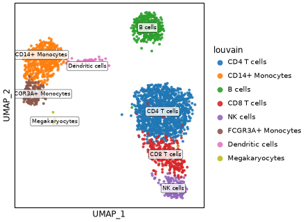 |

| Scanpy | ggann |
|:---:|:---:|
| 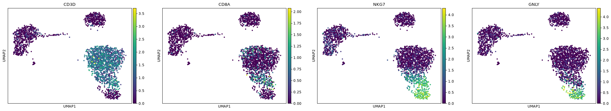 | 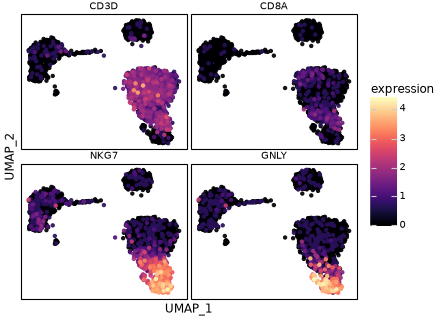 |

### Aggregated expression

| Scanpy dotplot | ggann dotplot | Scanpy matrixplot | ggann matrixplot |
|:---:|:---:|:---:|:---:|
| 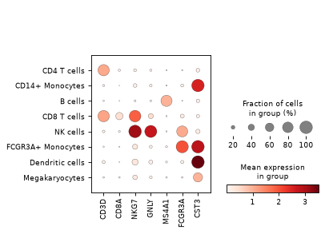 | 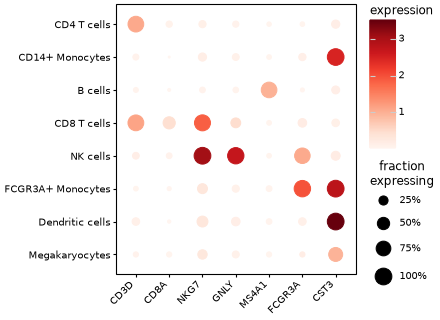 | 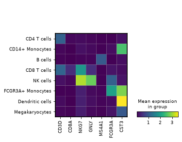 | 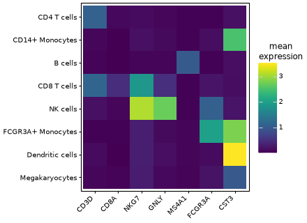 |

### Distributions

| Scanpy stacked violin | ggann | Scanpy violin | ggann |
|:---:|:---:|:---:|:---:|
| 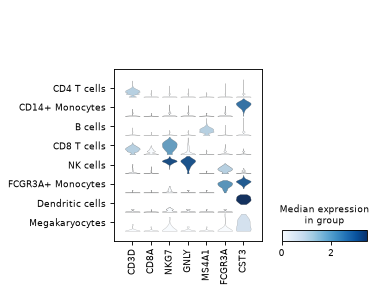 | 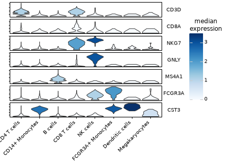 | 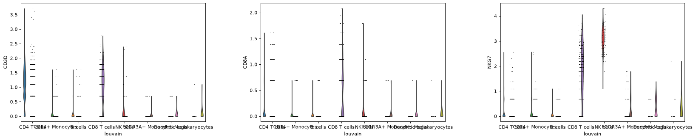 | 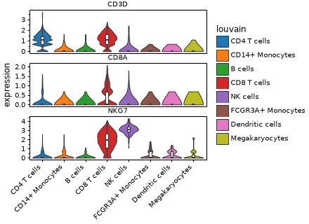 |

| Scanpy tracksplot | ggann tracksplot |
|:---:|:---:|
| 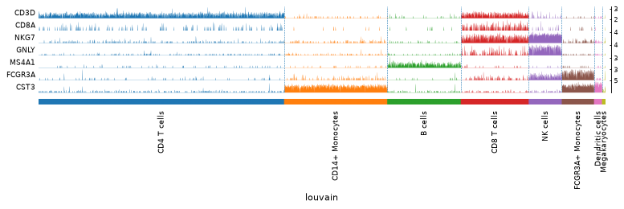 | 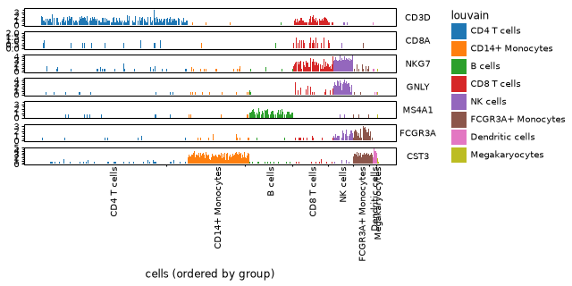 |

### Other summaries

| Scanpy correlation | ggann | Scanpy highest-expressed | ggann |
|:---:|:---:|:---:|:---:|
| 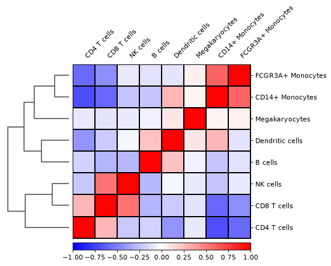 | 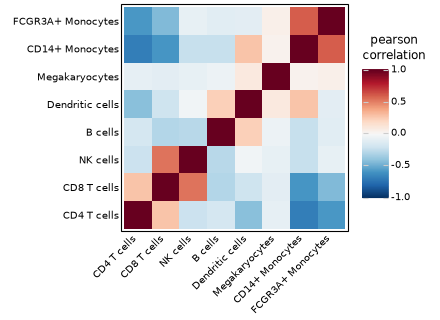 | 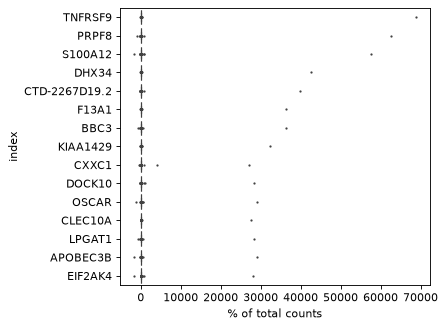 | 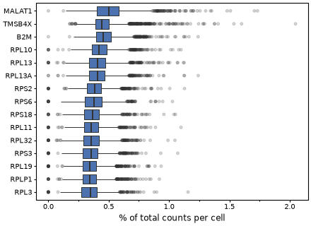 |

| Scanpy ranked genes | ggann ranked genes |
|:---:|:---:|
| 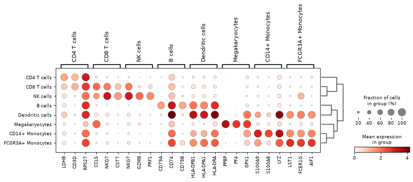 | 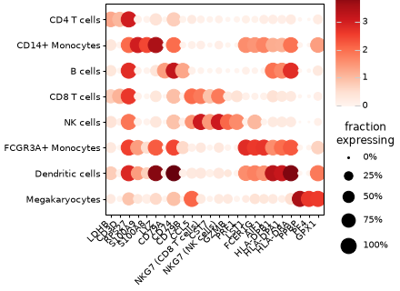 |

## Benchmarking parity

Do not infer speed from these figures. The {doc}`performance` protocol validates
statistical and structural equivalence before timing matched preparation,
construction, rendering, end-to-end output, and memory.

For a task-oriented choice between the two plotting paths, including matched
offline examples, explicit source selectors, materialization budgets, measured
absolute timings, and an honest trade-off table, see
{doc}`vignettes/scanpy_tradeoffs`.
