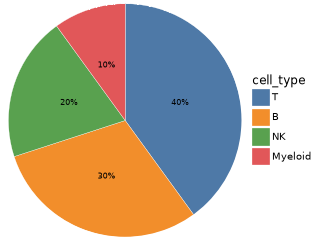
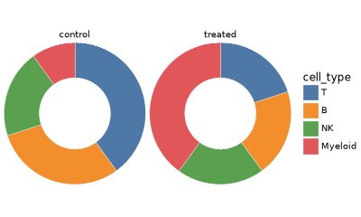
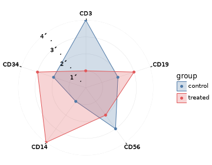

# Shapes

`ggann.shapes` adds layers for shapes plotnine does not draw. This page covers curves, pies and rings, and radar plots. Every layer is a plain plotnine layer, so you add it with `+` and combine it with any geom, scale, facet or theme.

All examples come from `examples/docs_figures/shapes.py`.

## Curves

`geom_curve` draws one bent line for each row of a data frame with `x`, `y`, `xend` and `yend`. `stat_curve` does the work: it replaces each row by `n` points on a quadratic Bezier curve and adds a `t` column from 0 to 1.

```python
import pandas as pd
from plotnine import aes, arrow, coord_equal, ggplot
import ggann as ag

df = pd.DataFrame({"x": [0.0], "y": [0.0], "xend": [4.0], "yend": [0.0]})
base = ggplot(df, aes("x", "y", xend="xend", yend="yend")) + coord_equal()
plot = base + ag.geom_curve(curvature=0.5, arrow=arrow(length=0.15))
```

The figure draws one segment from `(0, 0)` to `(4, 0)` three times, with `curvature` -0.5, 0 and 0.5. Each curve travels left to right.


Positive `curvature` bends right of the direction of travel, negative bends left, and 0 is a straight line. The bulge at the middle is `|curvature| / 2` of the segment length. The defaults are `curvature=0.5` and `n=50`. `n` must be an integer of at least 2, and `curvature` must be finite. A bad value raises `ValueError` when the plot is built.

Colour, size, alpha and linetype map per row and stay constant along a curve. `arrow`, `lineend` and `linejoin` go to the path geom.

### Limits

- **Curvature lives in data units.** The bend is computed in transformed scale units, so the shape is exact only when x and y share units, as under `coord_equal()`. A segment from `(0, 0)` to `(1, 1000)` at the default curvature reaches x = 250.5 and stretches the x scale about 250-fold. Under `scale_x_log10` the curve bends in log units.
- **Not for `coord_radial`.** There the path bends in (theta, r) space and can push r below 0. Curves under `coord_radial` are unsupported.
- **`group` is set by the stat.** It numbers the surviving rows 1 to k in each panel and replaces any mapped `group`.
- **Missing endpoints are dropped.** A row with a missing or non-finite `x`, `y`, `xend` or `yend` is removed with a warning. `na_rm=True` silences it.
- **Registry names are global.** plotnine keeps one registry keyed by class name. After `import ggann`, `geom_path(stat="curve")` resolves to `stat_curve` in every plot in the process. A same-named class from another package would replace ggann's silently, and a canary test checks that none exists.

There is no `ggcurve` constructor. Use the layers.

## Pie and ring

`ggpie` and `ggring` draw the share of each level of a column. Both take a data frame, so the same call works on a count table or on one row per cell.

```python
import pandas as pd
import ggann as ag

df = pd.DataFrame({"cell_type": ["T", "B", "NK", "Myeloid"], "n": [4, 3, 2, 1]})
plot = ag.ggpie(df, "cell_type", "n", order=["T", "B", "NK", "Myeloid"], label="percent")
ring = ag.ggring(df, "cell_type", "n", inner_radius=0.6)
```

The figure shows one pie of four slices with weights 4, 3, 2 and 1. Slices run clockwise from 12 o'clock in the order you give, and each label is the share of the total: 40%, 30%, 20% and 10%.



`value` names a column of non-negative weights. Leave it out to count rows. `split_by` draws one pie per level as facets, and each pie closes on its own total. `label` is `"none"`, `"count"` or `"percent"`; a zero slice gets no label. `start` turns the first edge, in radians, clockwise from 12 o'clock. `inner_radius` is the hole as a fraction of the outer radius: `ggpie` takes 0 up to but not including 1, and `ggring` takes values strictly between 0 and 1 (default 0.5).

Level order comes from the categorical order of the column, else sorted values, unless you pass `order`. `palette` is a dict that covers every level, a list, or a Matplotlib colormap name. A row with a missing level is dropped with a warning that gives the count. A negative weight raises `ValueError`.

For cells in an `AnnData`, `plot_proportions(adata, group_by, split_by, kind="pie")` or `kind="ring"` counts the cells and draws one pie or ring per `split_by` level, filled with the stored `obs` colours.

```python
plot = ag.plot_proportions(adata, "cell_type", "condition", kind="ring")
```

The figure shows two rings from that call. In the control ring T takes 40%, B 30%, NK 20% and Myeloid 10%. In the treated ring T, B and NK take 20% each and Myeloid 40%.



Angles are always shares of each pie's own total, so `normalize=False` draws the same angles as `normalize=True`. Small slices are not lumped into "Other", and a pie with 20 or more levels is hard to read: `unsupported: no inspected figure`.

### Layer tier

`stat_pie` turns weights into one row per slice with `xmin`, `xmax`, `ymin`, `ymax`, `y`, `x`, `count` and `prop`. `geom_pie` is `geom_rect` with that stat. The coord does the rest:

```python
from plotnine import aes, coord_radial, ggplot

plot = ggplot(df, aes(fill="cell_type", weight="n")) + ag.geom_pie() + coord_radial(theta="y", expand=False)
```

- **Set `expand=False`.** The default `coord_radial(theta="y")` expands the range, so the wedges cover only 0.909 of the circle.
- **Several `x` levels are concentric rings.** Each ring sums to 1. `width` sets the band width in `x` units.
- **Labels need `drop_zero=True`.** Use `geom_text(aes(label=after_stat("count")), stat=ag.stat_pie, drop_zero=True)`. Without it a zero slice gets a label on a slice edge.
- **A ring with total weight 0 is dropped** with a warning. A missing weight is removed with the usual plotnine warning; `na_rm=True` silences it.
- **A continuous `fill` makes one slice** with `group = -1`. The slice key is `group`.
- **Do not use `coord_radar` with a pie.** It draws wedges as straight chords.

## Radar

`ggradar` draws one polygon per series on evenly spaced spokes. The first level of `axis` sits at 12 o'clock and the rest follow clockwise.

```python
scores = pd.DataFrame(
    {
        "marker": ["CD3", "CD19", "CD56", "CD14", "CD34"] * 2,
        "score": [4, 2, 3, 1, 2, 1, 3, 2, 4, 3],
        "group": ["control"] * 5 + ["treated"] * 5,
    }
)
plot = ag.ggradar(scores, "marker", "score", series="group")
```

The figure draws that table. The control polygon reaches 4 on CD3 and 1 on CD14. The treated polygon reaches 4 on CD14 and 1 on CD3.



The radius is the value itself, drawn from 0 on one shared axis. There is no rescaling per spoke, so a spoke with small values stays near the centre. The default `rlim` is `(0, max(value))`. A value outside `rlim` raises `ValueError`, because the plot would censor it and the polygon would lose a vertex; this also rejects negative values at the default. The grid is circular. A radar needs at least 3 levels in `axis` and exactly one row for each `(axis, series)` pair. A missing label, a missing value and a repeated or absent pair raise `ValueError`. `series=None` draws one polygon. `fill_alpha`, `points`, `axis_order`, `series_order` and `palette` work as in `ggpie`. Many polygons or spokes become hard to read: `unsupported: no inspected figure`.

For cells, `plot_proportions(adata, group_by, split_by, kind="radar")` makes one spoke per `group_by` level and one polygon per `split_by` level. It needs at least 3 `group_by` levels. When `split_by` is set and `normalize=True`, you must choose what the radius means with `radar_norm`:

- `"within_split"`: each cell type's share of the cells in that `split_by` level, as the bars show.
- `"across_splits"`: the share of each cell type's cells that falls in that `split_by` level. Each spoke then sums to 1 over the polygons.

The two give different polygons, so ggann raises `ValueError` until you pick one. `normalize=False` draws counts and needs no choice.

### Layer tier

`stat_radar` sorts each series by `x` and appends its first row so the polygon closes. `geom_radar` is `geom_polygon` with that stat and `alpha=0.25`. `coord_radar` is `coord_radial` with straight edges: `coord_radial` draws each edge as a spiral. For K axes the recipe is:

```python
from math import pi
from plotnine import scale_x_discrete

K = 5
plot = (
    ggplot(scores, aes("marker", "score", group="group", fill="group", color="group"))
    + ag.geom_radar()
    + scale_x_discrete(expand=(0, 0.5))
    + ag.coord_radar(start=-pi / K)
)
```

- **`expand=(0, 0.5)` spaces the spokes evenly.** With the default expansion the angles are uneven.
- **`start=-pi / K` puts the first spoke at 12 o'clock.**
- **Start the radius at 0.** Default limits hide the smallest value near the centre. Values outside the limits are censored.
- **`ggradar` drops the radial tick at the lower limit.** matplotlib omits a tick at the origin and plotnine labels ticks by position, so a break at 0 shifts every label by one. The layer tier does not fix this; pass `breaks` above the lower limit.
- **A series with a missing spoke is drawn with one vertex fewer**, with no warning at this tier.
- **`coord_radar` turns off munching for every geom in the plot.**
