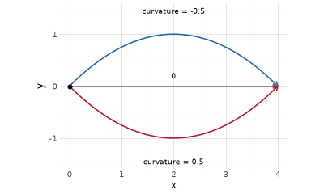
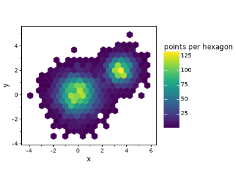

# Shapes

`ggann.shapes` adds layers for shapes plotnine does not draw. This page covers curves and hexagonal bins. Every layer is a plain plotnine layer, so you add it with `+` and combine it with any geom, scale, facet or theme.

All examples come from `examples/docs_figures/shapes.py`.

## Curves

`geom_curve` draws one bent line for each row of a data frame with `x`, `y`, `xend` and `yend`. `stat_curve` does the work: it replaces each row by `n` points on a quadratic Bezier curve and adds a `t` column from 0 to 1.

```python
import pandas as pd
from plotnine import aes, arrow, coord_equal, ggplot
import ggann as ag

df = pd.DataFrame({"x": [0.0], "y": [0.0], "xend": [4.0], "yend": [0.0]})
base = ggplot(df, aes("x", "y", xend="xend", yend="yend")) + coord_equal()
plot = base + ag.geom_curve(curvature=0.5, arrow=arrow(length=0.15))
```

The figure draws one segment from `(0, 0)` to `(4, 0)` three times, with `curvature` -0.5, 0 and 0.5. Each curve travels left to right.



Positive `curvature` bends right of the direction of travel, negative bends left, and 0 is a straight line. The bulge at the middle is `|curvature| / 2` of the segment length. The defaults are `curvature=0.5` and `n=50`. `n` must be an integer of at least 2, and `curvature` must be finite. A bad value raises `ValueError` when the plot is built.

Colour, size, alpha and linetype map per row and stay constant along a curve. `arrow`, `lineend` and `linejoin` go to the path geom.

### Limits

- **Curvature lives in data units.** The bend is computed in transformed scale units, so the shape is exact only when x and y share units, as under `coord_equal()`. A segment from `(0, 0)` to `(1, 1000)` at the default curvature reaches x = 250.5 and stretches the x scale about 250-fold. Under `scale_x_log10` the curve bends in log units.
- **Not for `coord_radial`.** There the path bends in (theta, r) space and can push r below 0. Curves under `coord_radial` are unsupported.
- **`group` is set by the stat.** It numbers the surviving rows 1 to k in each panel and replaces any mapped `group`.
- **Missing endpoints are dropped.** A row with a missing or non-finite `x`, `y`, `xend` or `yend` is removed with a warning. `na_rm=True` silences it.
- **Registry names are global.** plotnine keeps one registry keyed by class name. After `import ggann`, `geom_path(stat="curve")` resolves to `stat_curve` in every plot in the process. A same-named class from another package would replace ggann's silently, and a canary test checks that none exists.

There is no `ggcurve` constructor. Use the layers.

## Hexbin

`geom_hex` bins `x` and `y` into pointy-top hexagons and fills each by its count. `stat_binhex` does the work: it finds the nearest centre on a triangular lattice, counts the points, and emits six vertices per bin. `gghex(df, x, y, bins=...)` is the one-call form. plotnine has no hexbin layer, so ggann provides its own.

```python
import numpy as np
import pandas as pd
import ggann as ag

rng = np.random.default_rng(0)
cloud = pd.DataFrame(
    {
        "x": np.r_[rng.normal(0, 1, 4000), rng.normal(3.5, 0.7, 2000)],
        "y": np.r_[rng.normal(0, 1, 4000), rng.normal(2.0, 0.7, 2000)],
    }
)
plot = ag.gghex(cloud, "x", "y", bins=20)
```

The figure shows 6,000 points from two Gaussian clouds in 20 hexagons across x. Hexagons are regular because `gghex` adds `coord_equal()`.



**Size has no default.** Give `bins` or `binwidth`; with neither the plot raises `ValueError` when it is built. A scalar `bins` sets the width to the x range over `bins` and the height to `2 * width / sqrt(3)`, which is regular under `coord_equal()`. A pair `bins=(nx, ny)` sets width to the x range over `nx` and height to the y range over `ny`. `binwidth` is in scale units, wins over `bins`, and takes a number (width; same height rule) or a pair `(width, height)`.

**Lattice origin.** The lattice starts at the lower end of the x and y scale limits. Facets with fixed scales share one lattice; with `scales="free"` each panel has its own. Binning runs after scale transforms, so a log axis bins in log units.

**Statistics.** `fill` defaults to `after_stat("count")`. `density` is `count / sum(count)` and `ncount` is `count / max(count)`, both per panel. `aes(weight=...)` sums weights instead of counting. `aes(z=...)` with `fun` (`"mean"`, `"median"`, `"sum"`, `"min"`, `"max"` or a callable) adds `value`; `fun` has no default and is required with `z`.

### Hexbin in `plot_embedding`

`plot_embedding(adata, "umap", hex=True, hex_bins=30)` bins the cells. With no `color`, the fill is the cell count and the legend reads `cells`. With a numeric `color`, add `hex_fun`; the fill is that summary of the value per hexagon. `split_by` facets with one shared lattice. `hex_bins` is required, and `hex_bins` or `hex_fun` without `hex=True` raises. These cases raise `ValueError` instead of choosing for you:

- a categorical `color`, because a majority label would hide minority cells;
- `downsample`, because the cells to bin are then ambiguous;
- `vmin`, `vmax` or `vcenter`, because limits on cells and on hexagon values differ;
- a missing numeric value, because skipping it or propagating it changes the summary;
- a set `pointdensity` or `method`, and `backend="matplotlib"`.

`size`, `alpha`, `sort_order` and `na_color` have no effect with `hex=True`. The plot data stays the per-cell table; `plot.layer_data(0)` holds the hexagons.

### Limits

- **Seams.** `geom_hex` copies the fill into the outline at width 0.2, which hides white hairlines between hexagons. It does not do so when you set `color`, when `alpha` is below 1 (an opaque outline would draw a grid) or mapped. A constant `fill` becomes the outline colour.
- **Continuous scales only.** A discrete x or y raises `TypeError`.
- **Missing values.** Rows with a missing or non-finite `x` or `y` are dropped with a warning (`na_rm=True` silences it). Points outside scale limits are dropped the same way. A missing `z` or `weight` raises `ValueError`.
- **`group` is set by the stat.** It numbers the bins 1 to k in each panel, replaces any mapped `group`, and a mapped discrete `color` is dropped because the stat pools all groups.
- **Vector size.** One polygon is drawn per bin. `raster=True` rasterises the layer.
