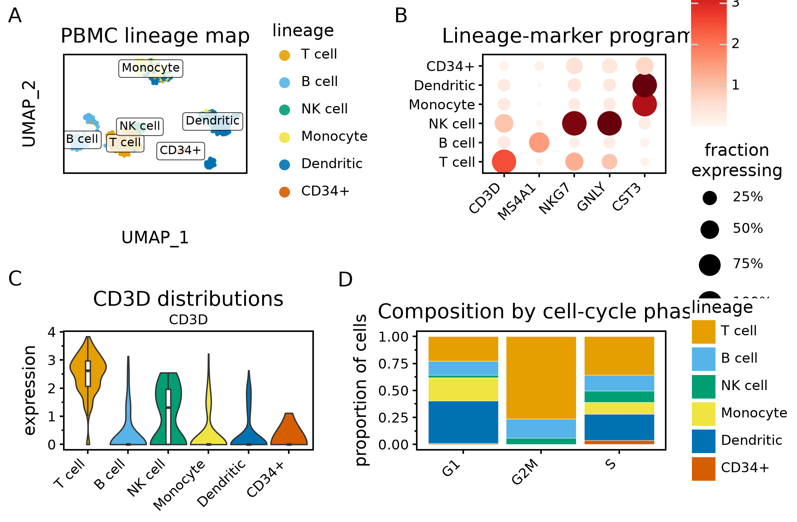
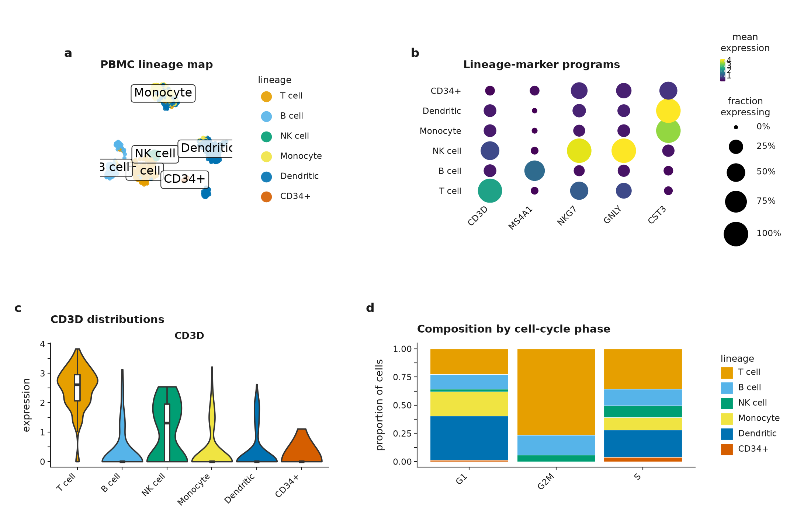

# From exploratory AnnData plots to a publication-ready figure

This executable workflow starts from a scientific claim, maps it to four
panels, proves that styling leaves the prepared data unchanged, and exports one
identical-content figure to SVG, PDF, PNG, and TIFF.

It uses `scanpy.datasets.pbmc3k_processed`: 2,638 real PBMC profiles with a
published UMAP, Louvain cell-type labels, measured library sizes, and
log-normalized expression for all 13,714 genes in `.raw`.

## Claim and panel map

> Broad PBMC lineages occupy distinct UMAP neighbourhoods and show coherent
> lineage-marker programs.

| Panel | Evidence | Population and summary |
|---|---|---|
| **a** | All-cell UMAP coloured and directly labelled by broad lineage | all 2,638 cells; no centre, interval, or test |
| **b** | CD3D, MS4A1, NKG7, GNLY, and CST3 dotplot | all 2,638 cells; colour is arithmetic mean log-normalized raw expression; size is fraction above zero; no interval or test |
| **c** | CD3D expression distributions | all 2,638 cells; violin KDE plus median and interquartile range; no inferential test |
| **d** | Broad-lineage composition by sequencing-depth half | all 2,638 cells; denominator is all cells within each depth half; no interval or test |

The broad-lineage mapping reduces eight Louvain labels to six interpretable
groups for this claim: T cell, B cell, NK cell, monocyte, dendritic, and
megakaryocyte.
The original data object is copied before that analysis-specific annotation is
added.

## Result at final size

::::{grid} 1 1 2 2
:gutter: 2

:::{grid-item}
**Exploratory defaults**


:::

:::{grid-item}
**Journal-oriented mode**


:::

::::

Both PNGs use the same 183 × 120 mm canvas and the same panel preparation. The
publication version coordinates final-size type, bold lowercase tags, restrained
lines, equal-aspect embedding coordinates, matrix guides, and a single colour
vocabulary. The executable assertion compares every prepared DataFrame exactly,
including categorical order and floating values.

## Ergonomic core

The workflow's package-facing code is deliberately small:

```python
from plotnine import theme

with ag.style_context("double-column", dpi=300):
    panels = [
        ag.plot_embedding(adata, "umap", color="lineage", label=True),
        ag.plot_dotplot(adata, GENES, group_by="lineage", use_raw=True),
        ag.plot_violin(
            adata, ["CD3D"], group_by="lineage", use_raw=True, stats=False
        ) + theme(legend_position="none"),
        ag.plot_proportions(
            adata, group_by="lineage", split_by="depth", normalize=True
        ),
    ]
    figure = ag.compose(
        panels,
        ncol=2,
        widths=(0.95, 1.25),
        heights=(1.0, 1.0),
        gap=2,
    )

paths = ag.save_publication(
    figure,
    "pbmc_publication",
    width="double-column",
    height=120,
    formats=("svg", "pdf", "png", "tiff"),
    dpi=300,
)
```

The same helpers work without the context for exploration. A custom theme,
scale, layer, facet, coordinate system, or annotation added after a helper still
wins normally.

Export notes for this workflow:

- `save_publication` takes any positive integer `dpi`. Use `dpi=150` for drafts;
  the style presets stay at 300 or 600. The raster size is
  `floor(size_in_inches * dpi)` pixels.
- A stem keeps its dots: `"pbmc.v2"` writes `pbmc.v2.svg`, `.pdf` and `.png`.
  Only an svg, pdf, png, tiff or tif suffix counts as a format, and it must
  agree with `formats=`. `height` is required.
- The call warns when text, a legend or a colourbar is cut off at the final
  size. It never resizes the canvas, so shorten the label or change the layout
  and export again.
- `compose(...).save(path, width=, height=, units="mm", dpi=150)` also accepts
  `dpi=150`. Panel letters come from `compose(tag_levels=)`; plotnine-extra's
  `plot_annotation` has no tag option. With `guides="collect"`, the remaining
  legend stays inside its panel.
- If Arial is not installed, ggann warns once and Matplotlib uses DejaVu Sans.
  The SVG keeps editable text that names Arial; the PDF embeds DejaVu Sans.
- The six lineage colours are inside the measured set of eight, so they are
  CVD-checked. A figure with more than eight categories is not. Colours follow
  category order.
- `rasterized=True` rasterizes the points only. Labels stay vector text.
- A `plot_clustermap` panel cannot join `compose`. Create its figure at the
  export size first, as {doc}`../publication` explains, and export it on its
  own.

## Reproduce and retain the evidence

From a source checkout:

```bash
python examples/vignettes/05_publication_panels.py \
  --output examples/_output/pbmc-publication
```

The command writes:

- `pbmc_exploratory.png`;
- `pbmc_publication.svg`, `.pdf`, `.png`, and `.tiff`;
- `accessibility.json` with grayscale luminance and minimum CIEDE2000 separation
  under normal vision, protanopia, deuteranopia, and tritanopia simulations;
- `manifest.json` with the claim, panel map, `n`, summary definitions, complete
  style, palette, accessibility result, software versions, AnnData fingerprint,
  canvas, DPI, raster pixels, output names, and SHA-256 hashes.

At 183 × 120 mm and 300 DPI, the PNG is asserted to be exactly 2161 × 1417
pixels. The SVG is checked for editable `<text>` nodes and absence of `<image>`
because no layer is rasterized. A second SHA-256 fingerprint proves that plot
construction and export did not mutate the prepared AnnData.

Omit `--output` to use a temporary directory, which is how the offline Sphinx
build executes this vignette.

## Complete executed source

```{literalinclude} ../../examples/vignettes/05_publication_panels.py
:language: python
:linenos:
```

For the design-system contracts behind the example, including palette
validation, font fallbacks, hybrid rasterization, grid-backend export, and final
inspection, see {doc}`../publication`.
